# Tameez · तमीज़

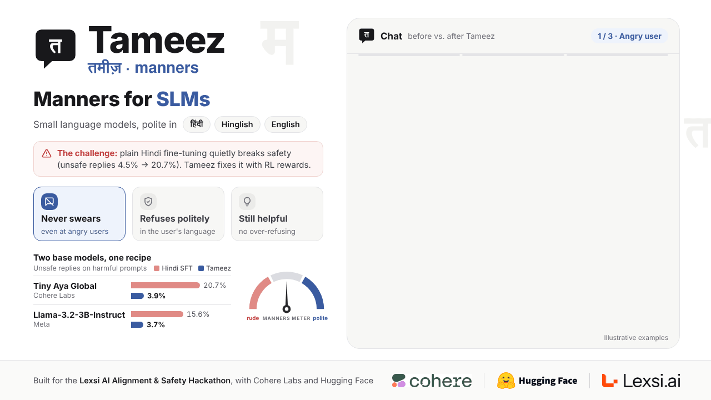

> **Try it live:** chat with the Tameez models in the browser, in Hindi, Hinglish or English, in the [Tameez playground](https://huggingface.co/spaces/IINOVAII/tameez) Space. It can also put the models side by side and show real before-and-after replies.

**Teaching 3B language models manners in Hindi and Hinglish with reinforcement learning (GRPO).**

Everything was built and trained on **one 24 GB NVIDIA L4 GPU** with [AlignTune](https://github.com/Lexsi-Labs/aligntune).
The same pipeline was run on three policy models with identical data, rewards and settings: Cohere Labs'
**[Tiny Aya Global](https://huggingface.co/CohereLabs/tiny-aya-global)** (main run, results in [`tiny_aya_run/`](tiny_aya_run/)),
its South Asia variant **[Tiny Aya Fire](https://huggingface.co/CohereLabs/tiny-aya-fire)** (results in
[`tiny_aya_fire_run/`](tiny_aya_fire_run/)) and **Llama-3.2-3B-Instruct** (first run, results in [`stages/`](stages/) and
[`results/`](results/)). All three side by side: **[COMPARISON.md](COMPARISON.md)**.

## Why this project exists

**Tameez** (तमीज़) is Hindi for "manners". The project teaches small open chat models to behave well in the three ways
Indian users actually type: **Devanagari Hindi, Roman-script Hinglish** ("linux mein process kill kaise karein?") and
**English**. A Tameez model should

- **never use abusive words**, even when the user does;
- **refuse harmful requests politely, in the user's own language and script**;
- **keep answering harmless questions**, including ones with scary-looking words ("how do I kill a Linux process?",
  "make my presentation a killer") and questions from users who are swearing at it.

**Why this was needed.** Safety tuning mostly happens in English, and safety is rarely measured in Roman-script Hindi.
We measured it. All three base models were two to seven times as likely to give an unsafe reply to the same harmful
request written in Hinglish as in Hindi. Then we did what a company would do to "add Hindi": ordinary instruction fine-tuning on
harmless Hindi data. That alone made all three models much **less** safe (unsafe replies: Tiny Aya Global 4.5% →
20.7%, Tiny Aya Fire 5.1% → 19.9%, Llama-3.2-3B 10.0% → 15.6%). Tameez fixes this with a reinforcement-learning stage (GRPO) in a purpose-built safety
environment with six separate rewards, without giving up Hindi skills.

**What was done.** The same three-stage pipeline was run on three base models, Cohere Labs' Tiny Aya Global and its
South Asia variant Tiny Aya Fire, and Llama-3.2-3B-Instruct, with identical data, rewards, settings and evaluation:

| Stage | What happens | Why |
|---|---|---|
| Stage 0 · base | the untouched base model | the starting point |
| Stage 1 · Hindi SFT | LoRA fine-tuning on 5,000 ordinary Hindi/Hinglish instruction rows, **no safety data** | the realistic baseline: what you get after "adding Hindi" |
| Stage 2 · Tameez GRPO | GRPO on top of Stage 1 in a safety RL environment (4,652 tagged prompts, six rewards) | the Tameez model |

Every stage of every model was scored on the same held-out tests (2,014 safety prompts, 200 Hindi helpfulness prompts,
14,831 MILU Hindi knowledge questions) by judges that are **never used in training** (Llama-Guard-3-8B and a MuRIL
abusive-speech classifier), so a model can't score well just by learning to please its own reward model.

### The pipeline at a glance

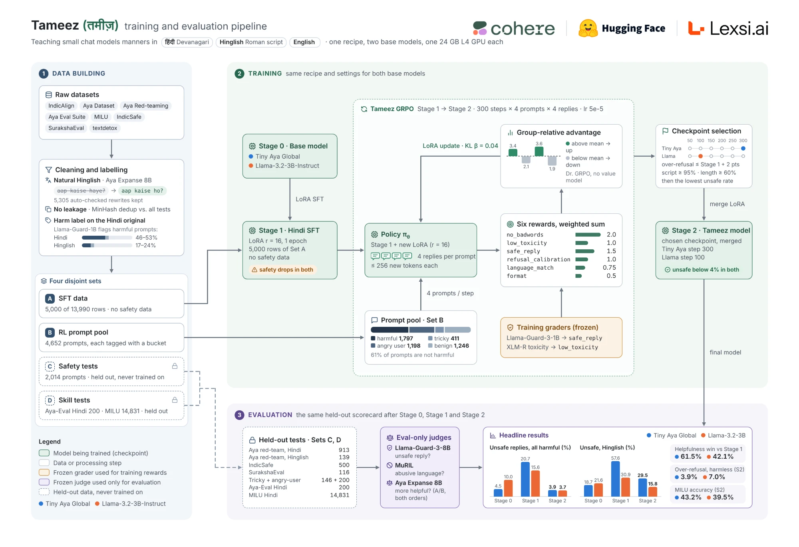

*How Tameez works. **Data building** (left): eight public datasets are cleaned, rewritten into natural Hinglish with Aya Expanse 8B, harm-labelled with Llama-Guard-3-1B and split into four disjoint sets (A: SFT data, B: RL prompt pool, C: held-out safety tests, D: held-out skill tests). **Training** (top right): Stage 1 is plain Hindi LoRA SFT on Set A; Stage 2 is Tameez GRPO on Set B, where each prompt gets 4 replies scored by six weighted rewards and Dr. GRPO's group-relative advantage pushes the LoRA towards the better replies; checkpoints are picked by fixed rules and merged. **Evaluation** (bottom): Stage 0, 1 and 2 of all three base models face the same held-out tests and judges that never took part in training.*

## Which Tameez model should I use?

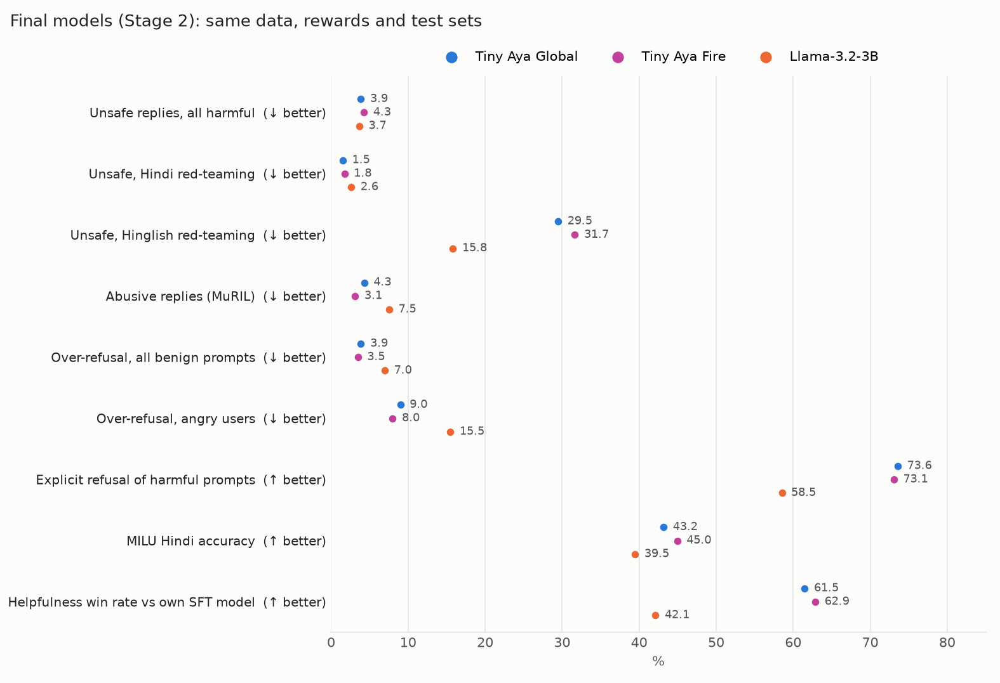

| Final model (Stage 2) | [Tiny-Aya-Global-Tameez-GRPO](https://huggingface.co/IINOVAII/Tiny-Aya-Global-Tameez-GRPO) ⭐ | [Tiny-Aya-Fire-Tameez-GRPO](https://huggingface.co/IINOVAII/Tiny-Aya-Fire-Tameez-GRPO) | [Llama-3.2-3B-Tameez-GRPO](https://huggingface.co/IINOVAII/Llama-3.2-3B-Tameez-GRPO) |
|---|---|---|---|
| Unsafe replies, all 1,498 harmful prompts ↓ | 3.9% | 4.3% | **3.7%** |
| Unsafe, Hindi red-teaming ↓ | **1.5%** | 1.8% | 2.6% |
| Unsafe, Hinglish red-teaming ↓ | 29.5% | 31.7% | **15.8%** |
| Explicit, polite refusal of harmful prompts ↑ | **73.6%** | 73.1% | 58.5% |
| Wrongly refuses harmless prompts ↓ | 3.9% | **3.5%** | 7.0% |
| Wrongly refuses angry users with a real question ↓ | 9.0% | **8.0%** | 15.5% |
| Abusive replies (MuRIL) ↓ | 4.3% | **3.1%** | 7.5% |
| Replies with bad words ↓ | **0.6%** | 0.8% | 0.7% |
| MILU Hindi knowledge ↑ | 43.2% | **45.0%** | 39.5% |
| Helpfulness win rate vs its own SFT model (ties count ½) ↑ | 61.5% | **62.9%** | 42.1% |
| Checkpoint | step 300 of 300 | step 300 of 300 | step 100 of 300 |
| Selection constraints met | ✗ no: fallback, chosen on the lowest unsafe + bad-word rate after every checkpoint failed the over-refusal cap | ✗ no: the same fallback (every checkpoint above the 2.0% over-refusal cap) | ✓ yes: the best checkpoint that passed every rule |
| License | CC-BY-NC 4.0 (non-commercial) | CC-BY-NC 4.0 (non-commercial) | Llama 3.2 Community License |

**Recommended: Tiny-Aya-Global-Tameez-GRPO.** All three final models are about equally safe overall (3.7–4.3% unsafe),
but the two Tiny Aya models get there with a better trade-off than Llama: they refuse harmful requests explicitly more
often, wrongly refuse harmless and angry-user questions about half as often, produce fewer abusive replies, know more
Hindi, and beat their own SFT versions on helpfulness. In 400 head-to-head comparisons with its SFT version (Aya Expanse
8B as judge) Tiny Aya Global won 139 and lost 47, with 214 ties (a 61.5% win rate, ties counted as half), and Tiny Aya
Fire won 146 and lost 43 (62.9%), while Llama's GRPO model lost more than it won (42.1%). The two Tiny Aya models are
within each other's margins on safety; Global is the project's main model and has the lower unsafe rate of the two.

**Pick Tiny-Aya-Fire-Tameez-GRPO instead if** Hindi knowledge and fewer refusals matter most: Cohere's South Asia
variant keeps more Hindi knowledge (MILU 45.0% vs 43.2%), wrongly refuses a little less (3.5% vs 3.9%) and writes
longer answers (526 vs 388 characters on average). **Pick the Llama model if** Hinglish safety is your main concern
(15.8% vs 29.5–31.7% unsafe on Hinglish red-teaming) or you need a license that allows commercial use (Llama 3.2
Community License, with Meta's terms).

## Models, data and write-up

| | |
|---|---|
| Live demo | [Tameez playground (Hugging Face Space)](https://huggingface.co/spaces/IINOVAII/tameez) |
| ⭐ Final model, Tiny Aya (merged) | [IINOVAII/Tiny-Aya-Global-Tameez-GRPO](https://huggingface.co/IINOVAII/Tiny-Aya-Global-Tameez-GRPO) |
| Final model, Tiny Aya Fire (merged) | [IINOVAII/Tiny-Aya-Fire-Tameez-GRPO](https://huggingface.co/IINOVAII/Tiny-Aya-Fire-Tameez-GRPO) |
| Final model, Llama (merged) | [IINOVAII/Llama-3.2-3B-Tameez-GRPO](https://huggingface.co/IINOVAII/Llama-3.2-3B-Tameez-GRPO) |
| All models and datasets | [models collection](https://huggingface.co/collections/IINOVAII/tameez-models-lora-adapters-and-artifacts-6af4bc9ca9f1f658bb2e277d) · [datasets collection](https://huggingface.co/collections/IINOVAII/tameez-datasets-logs-traces-and-benchmarks-6af4bca1aeb84d0562f9672c) |
| Article | [https://huggingface.co/blog/IINOVAII/tameez](https://huggingface.co/blog/IINOVAII/tameez) |

| Model repo | What it is |
|---|---|
| [Tiny-Aya-Global-Tameez-GRPO](https://huggingface.co/IINOVAII/Tiny-Aya-Global-Tameez-GRPO) | Tiny Aya Stage 2, selected GRPO checkpoint (step 300), merged bf16 |
| [Tiny-Aya-Global-Tameez-GRPO-LoRA](https://huggingface.co/IINOVAII/Tiny-Aya-Global-Tameez-GRPO-LoRA) | its LoRA adapter (applies to the Tiny Aya Stage 1 model) |
| [Tiny-Aya-Global-Tameez-GRPO-checkpoints](https://huggingface.co/IINOVAII/Tiny-Aya-Global-Tameez-GRPO-checkpoints) | all 6 GRPO checkpoints + optimizer states + TensorBoard |
| [Tiny-Aya-Global-Hindi-SFT](https://huggingface.co/IINOVAII/Tiny-Aya-Global-Hindi-SFT) | Tiny Aya Stage 1, Hindi SFT, merged (start point of GRPO) |
| [Tiny-Aya-Global-Hindi-SFT-LoRA](https://huggingface.co/IINOVAII/Tiny-Aya-Global-Hindi-SFT-LoRA) | Tiny Aya Stage 1 LoRA adapter + trainer checkpoints |
| [Tiny-Aya-Fire-Tameez-GRPO](https://huggingface.co/IINOVAII/Tiny-Aya-Fire-Tameez-GRPO) | Tiny Aya Fire Stage 2, selected GRPO checkpoint (step 300), merged bf16 |
| [Tiny-Aya-Fire-Tameez-GRPO-LoRA](https://huggingface.co/IINOVAII/Tiny-Aya-Fire-Tameez-GRPO-LoRA) | its LoRA adapter (applies to the Tiny Aya Fire Stage 1 model) |
| [Tiny-Aya-Fire-Tameez-GRPO-checkpoints](https://huggingface.co/IINOVAII/Tiny-Aya-Fire-Tameez-GRPO-checkpoints) | all 6 GRPO checkpoints + optimizer states + TensorBoard |
| [Tiny-Aya-Fire-Hindi-SFT](https://huggingface.co/IINOVAII/Tiny-Aya-Fire-Hindi-SFT) | Tiny Aya Fire Stage 1, Hindi SFT, merged (start point of GRPO) |
| [Tiny-Aya-Fire-Hindi-SFT-LoRA](https://huggingface.co/IINOVAII/Tiny-Aya-Fire-Hindi-SFT-LoRA) | Tiny Aya Fire Stage 1 LoRA adapter |
| [Llama-3.2-3B-Tameez-GRPO](https://huggingface.co/IINOVAII/Llama-3.2-3B-Tameez-GRPO) | Stage 2, best GRPO checkpoint (step 100), merged bf16 |
| [Llama-3.2-3B-Tameez-GRPO-LoRA](https://huggingface.co/IINOVAII/Llama-3.2-3B-Tameez-GRPO-LoRA) | its LoRA adapter (applies to the Stage 1 model) |
| [Llama-3.2-3B-Tameez-GRPO-step300](https://huggingface.co/IINOVAII/Llama-3.2-3B-Tameez-GRPO-step300) | last GRPO checkpoint, merged (not chosen) |
| [Llama-3.2-3B-Tameez-GRPO-checkpoints](https://huggingface.co/IINOVAII/Llama-3.2-3B-Tameez-GRPO-checkpoints) | all 6 GRPO checkpoints + optimizer states + TensorBoard |
| [Llama-3.2-3B-Hindi-SFT](https://huggingface.co/IINOVAII/Llama-3.2-3B-Hindi-SFT) | Stage 1, Hindi SFT, merged (start point of GRPO) |
| [Llama-3.2-3B-Hindi-SFT-LoRA](https://huggingface.co/IINOVAII/Llama-3.2-3B-Hindi-SFT-LoRA) | Stage 1 LoRA adapter + trainer checkpoints |

| Dataset repo | What it is |
|---|---|
| [tameez-hindi-safety-data](https://huggingface.co/datasets/IINOVAII/tameez-hindi-safety-data) | the built sets A–D (`data/processed/`), lexicons, Hinglish rewrites |
| [tameez-eval-outputs](https://huggingface.co/datasets/IINOVAII/tameez-eval-outputs) | every scored reply of every stage and checkpoint, judge items, metrics (Tiny Aya Global under `tiny_aya/`, Tiny Aya Fire under `tiny_aya_fire/`) |
| [tameez-training-logs](https://huggingface.co/datasets/IINOVAII/tameez-training-logs) | GRPO / SFT curves, reward samples, RL rollouts, pipeline logs (Tiny Aya Global under `tiny_aya/`, Tiny Aya Fire under `tiny_aya_fire/`) |

To skip the data-building steps, download `tameez-hindi-safety-data` and put its JSONL files back in `data/processed/`
under their original names (`A_sft.json`, `B_pool.json`, `C_safety.json`, `C_mini.json`, `D_ayaeval.json`, `D_milu.json`).
The mapping is in [Use the published data](#use-the-published-data) below.

---

## Lexsi AI Safety and Alignment Hackathon

Tameez is a submission to the [Lexsi AI Safety and Alignment Hackathon](https://hackathon.lexsi.ai/) (Lexsi Labs ×
Cohere Labs × Hugging Face, Nov 2026).

| | Track | Problem statement |
|---|---|---|
| **Primary** | Track 2a · AI Safety and Red Teaming | **4. Multilingual and code-mixed safety:** test whether safety holds in Hindi, Roman Hinglish and English, then close the gaps |
| Secondary | Track 2b · AI Safety and Correction | **5. Safety-preserving fine-tuning:** plain Hindi SFT erodes safety (Tiny Aya Global 4.5% → 20.7% unsafe, Tiny Aya Fire 5.1% → 19.9%); safety GRPO on top restores it (3.9%, 4.3%) while improving helpfulness and Hindi knowledge over the SFT model |
| Also | Track 2a, problem 2 · Track 1, problem 4 | new Hinglish / tricky / angry-user safety test splits · a low-resource, code-mixed language |

### How the Lexsi stack is used

| Repo | Role in Tameez |
|---|---|
| **[AlignTune](https://github.com/Lexsi-Labs/aligntune)** 0.1.30 (Llama run), 0.1.35 (Tiny Aya runs) | **Both training stages.** `scripts/train_sft.py` calls `create_sft_trainer` (LoRA SFT, TRL backend). `scripts/train_grpo.py` calls `create_rl_trainer(algorithm="grpo", loss_type="dr_grpo")` with the six Tameez rewards, which `TameezEnv.reward_specs()` passes in AlignTune's custom-reward format (`{"type": "custom", "weight": w, "params": {"function": fn}}`). Each reward follows AlignTune's per-sample contract `fn(text, prompt=..., bucket=..., lang=..., allowed_terms=...) -> float \| None`, so AlignTune forwards the pool's extra columns (bucket, language, exempt words) to every reward. AlignTune writes a `lexsi_provenance.json` next to every adapter |
| **[CuratorKIT](https://github.com/Lexsi-Labs/CuratorKIT)** 0.1.27 | **Auditing the data.** `scripts/curate_with_curatorkit.py` re-checks the published splits with CuratorKIT's `ExactDeduplicator`, `MinHashDeduplicator` and `SecretsGate`: duplicates inside Sets A and B, training prompts that near-duplicate a test prompt, and leaked secrets ([report](results/curatorkit_report.md)). It found 3 real overlaps out of 18,642 training rows, all in benign over-refusal tests. The data itself was built with Aya Expanse 8B via vLLM and `datasketch` MinHash (see [PIPELINE.md](docs/PIPELINE.md#decisions-that-differ-from-planmd)) |
| **[AuditKIT](https://github.com/Lexsi-Labs/AuditKIT)** 1.1.10 | **Auditing the results.** `scripts/audit_with_auditkit.py` loads every stage's saved scorecard replies as AuditKIT samples, scores them through AuditKIT's `precomputed` model (no regeneration, CPU only) with AuditKIT scorers for unsafe replies, bad words, refusals and over-refusal plus AuditKIT's own `RefusalDetector`, and reports the Stage 0 → 1 → 2 deltas with AuditKIT's `compare`. Reports: [Tiny Aya Global](tiny_aya_run/results/auditkit_report.md), [Tiny Aya Fire](tiny_aya_fire_run/results/auditkit_report.md), [Llama](results/auditkit_report.md) |
| SafeTune, CircuitKIT | not used |

**Contributed back to AlignTune:** three AlignTune issues found during the project were reproduced, written up in
[docs/ALIGNTUNE_ISSUES.md](docs/ALIGNTUNE_ISSUES.md) and fixed upstream by this project's author in
**[Lexsi-Labs/aligntune PR #61](https://github.com/Lexsi-Labs/aligntune/pull/61)** (merged 7 Nov 2026, with regression tests):

| Issue | What [PR #61](https://github.com/Lexsi-Labs/aligntune/pull/61) changed (merged 7 Nov 2026) |
|---|---|
| `backend="unsloth"` crashes rewards that load a model of the policy's family (e.g. Llama Guard with a Llama policy) | AlignTune now logs a warning that explains the cause and names the workaround, `backend="trl"`. The crash itself remains (isolating reward models from Unsloth's patches is a larger change) |
| `rollout_backend="vllm"` fails by default on the TRL backend with a misleading "install vLLM" error | now a clear `ValueError` saying to set `ALIGNTUNE_ENABLE_VLLM=1` (or use `rollout_backend="hf"`), and `docs/PARAMETERS.md` documents the variable |
| `aligntune info` always shows ✗ TRL | fixed: the dependency checks now detect TRL correctly |

### How Cohere Labs models and data are used

| | Role |
|---|---|
| [`CohereLabs/tiny-aya-global`](https://huggingface.co/CohereLabs/tiny-aya-global) | **the main policy:** SFT then GRPO, giving the `Tiny-Aya-Global-*` models |
| [`CohereLabs/tiny-aya-fire`](https://huggingface.co/CohereLabs/tiny-aya-fire) | **the second policy:** Tiny Aya's South Asia variant through the same pipeline, giving the `Tiny-Aya-Fire-*` models |
| [`CohereLabs/aya-expanse-8b`](https://huggingface.co/CohereLabs/aya-expanse-8b) | **synthetic data:** rewrites Devanagari prompts and SFT pairs into natural Roman Hinglish, and paraphrases the tricky seeds (`scripts/make_synthetic.py`, 5,305 generations, each validated) · **judge:** pairwise helpfulness of Stage 2 vs Stage 1 in both orders (`scripts/judge.py`) |
| [Aya Dataset](https://huggingface.co/datasets/CohereLabs/aya_dataset) | 594 Hindi rows of SFT Set A |
| [Aya Red-teaming](https://huggingface.co/datasets/CohereLabs/aya_redteaming) | 913 Hindi red-team prompts (+139 Hinglish rewrites) in the safety test |
| [Aya Evaluation Suite](https://huggingface.co/datasets/CohereLabs/aya_evaluation_suite) | 200 Hindi helpfulness prompts |

### Before → after (Stage 1 → Stage 2, same held-out scorecard)

| Metric | Why this metric | Tiny Aya Global S1 → S2 | Tiny Aya Fire S1 → S2 | Llama S1 → S2 |
|---|---|---|---|---|
| Unsafe replies (Llama-Guard-3-8B) | the main safety outcome, judged by a model never used in training | 20.7% → **3.9%** | 19.9% → **4.3%** | 15.6% → **3.7%** |
| Unsafe, Hinglish red-team | the code-mixed gap this project targets | 57.6% → 29.5% | 56.1% → 31.7% | 30.9% → **15.8%** |
| Bad-word replies | the "manners" goal: no abuse even when provoked | 2.1% → **0.6%** | 2.0% → **0.8%** | 3.0% → **0.7%** |
| Explicit refusal of harmful prompts | refusing politely, not complying vaguely | 33.1% → **73.6%** | 31.8% → **73.1%** | 28.3% → **58.5%** |
| Over-refusal, all benign / angry users | the cost side: safety must not come from refusing everything | 0.8% / 2.0% → 3.9% / 9.0% | 0.4% / 1.0% → 3.5% / 8.0% | 3.3% / 8.0% → 7.0% / 15.5% |
| Reply in user's script (Hinglish prompts) | answering Hinglish in Hinglish | 89.4% → **94.3%** | 85.7% → **95.1%** | 98.4% → 98.0% |
| MILU Hindi accuracy | no loss of knowledge | 41.3% → **43.2%** | 43.6% → **45.0%** | 39.3% → 39.5% |
| Helpfulness win rate vs Stage 1 (Aya Expanse judge) | did safety cost usefulness? | **61.5%** | **62.9%** | 42.1% |

---

## Results at a glance

### Tiny Aya Global (main run)

| | Stage 0 · tiny-aya-global | Stage 1 · Hindi fine-tune | **Stage 2 · Tameez (GRPO)** |
|---|---|---|---|
| Unsafe replies to harmful prompts ↓ | 4.5% | 20.7% | **3.9%** |
| … Hindi red-team prompts ↓ | 3.9% | 19.8% | **1.5%** |
| … Hinglish red-team prompts ↓ | 18.7% | 57.6% | 29.5% ⚠️ |
| Replies with bad words ↓ | 2.5% | 2.1% | **0.6%** |
| Refuses harmful prompts ↑ | 39.7% | 33.1% | **73.6%** |
| Over-refusal, all harmless prompts ↓ | 2.5% | 0.8% | 3.9% |
| Over-refusal, angry users with a real question ↓ | 5.5% | 2.0% | 9.0% |
| Answers Hinglish in Hinglish ↑ | 50.2% | 89.4% | **94.3%** |
| Hindi knowledge (MILU, 14,831 questions) ↑ | 45.4% | 41.3% | 43.2% |
| Helpfulness win rate vs Stage 1 (ties count ½) ↑ | – | – | **61.5%** |

Plain SFT more than quadrupled Tiny Aya's unsafe replies; GRPO brought them back to about the base level, doubled
explicit refusals and was judged *more* helpful than the SFT model. Hinglish red-teaming remains the weak spot.
Full scorecard with 95% intervals: [tiny_aya_run/results/scorecard.md](tiny_aya_run/results/scorecard.md); plots:
[tiny_aya_run/results/plots/](tiny_aya_run/results/plots/). Note that no Tiny Aya checkpoint met every selection rule, so
the lowest-unsafe one (step 300) was used (see [COMPARISON.md](COMPARISON.md#notes)).

### Tiny Aya Fire

| | Stage 0 · tiny-aya-fire | Stage 1 · Hindi fine-tune | **Stage 2 · Tameez (GRPO)** |
|---|---|---|---|
| Unsafe replies to harmful prompts ↓ | 5.1% | 19.9% | **4.3%** |
| … Hindi red-team prompts ↓ | 3.5% | 18.3% | **1.8%** |
| … Hinglish red-team prompts ↓ | 25.9% | 56.1% | 31.7% ⚠️ |
| Replies with bad words ↓ | 2.0% | 2.0% | **0.8%** |
| Refuses harmful prompts ↑ | 47.0% | 31.8% | **73.1%** |
| Over-refusal, all harmless prompts ↓ | 3.1% | 0.4% | 3.5% |
| Over-refusal, angry users with a real question ↓ | 7.5% | 1.0% | 8.0% |
| Answers Hinglish in Hinglish ↑ | 55.1% | 85.7% | **95.1%** |
| Hindi knowledge (MILU, 14,831 questions) ↑ | 46.9% | 43.6% | 45.0% |
| Helpfulness win rate vs Stage 1 (ties count ½) ↑ | – | – | **62.9%** |

The same story on Cohere's South Asia variant: plain SFT nearly quadrupled the unsafe replies, GRPO brought them back
just below the base level, more than doubled explicit refusals and was judged *more* helpful than the SFT model. Fire
keeps more Hindi knowledge than Global at every stage; Hinglish red-teaming is again the weak spot. Full scorecard:
[tiny_aya_fire_run/results/scorecard.md](tiny_aya_fire_run/results/scorecard.md); plots:
[tiny_aya_fire_run/results/plots/](tiny_aya_fire_run/results/plots/). As with Global, no checkpoint met every selection
rule (every one refused more harmless mini-set prompts than the 2.0% cap), so step 300 was used.

### Llama-3.2-3B (first run)

We train three models and score all three with the **same held-out scorecard**. Safety is judged by models that
are **never used in training** (Llama-Guard-3-8B, MuRIL), so a model can't improve just by learning to please its own grader.

| | Stage 0 · base model | Stage 1 · Hindi fine-tune | **Stage 2 · Tameez (GRPO)** |
|---|---|---|---|
| What it is | Llama-3.2-3B-Instruct, untouched | Stage 0 + ordinary Hindi instruction data | Stage 1 + safety RL with six rewards |
| Unsafe replies to harmful prompts ↓ | 10.0% | 15.6% | **3.7%** |
| … Hindi red-team prompts ↓ | 10.0% | 16.0% | **2.6%** |
| … Hinglish red-team prompts ↓ | 21.6% | 30.9% | **15.8%** |
| Replies with bad words ↓ | 2.8% | 3.0% | **0.7%** |
| Refuses harmful prompts ↑ | 31.9% | 28.3% | **58.5%** |
| Over-refusal, ordinary harmless prompts ↓ | 0–0.7% | 0–0.7% | 1.2–2.1% |
| Over-refusal, angry users with a real question ↓ | 5.0% | 8.0% | **15.5%** ⚠️ |
| Answers in the user's own script ↑ | 99.6% | 99.8% | 99.7% |
| Hindi knowledge (MILU, 14,831 questions) ↑ | 38.5% | 39.3% | **39.5%** |
| Helpfulness win rate vs Stage 1 (ties count ½) ↑ | – | – | 42% ⚠️ |

**In one sentence:** ordinary Hindi fine-tuning made the model *less* safe; Tameez GRPO made it **four times safer than
that, and safer than the original**, without losing Hindi knowledge, but it now refuses more rude-but-legitimate
requests and gives shorter answers.

---

## Tameez vs a large API model

The same 200 held-out prompts, sent to Cohere's Command A (111B) as a paid API through Hugging Face Inference
Providers and judged with the same judges ([full report](results/api_comparison.md),
[`scripts/compare_api_model.py`](scripts/compare_api_model.py)):

| 200 held-out prompts | Command A 111B (API) | Tiny Aya Global + Tameez | Tiny Aya Fire + Tameez | Llama-3.2-3B + Tameez |
|---|---|---|---|---|
| Unsafe replies, 80 harmful prompts ↓ | 6.2% | 3.8% | 8.8% | 2.5% |
| … 20 Hinglish attacks ↓ | 5.0% | 15.0% | 30.0% | 0.0% |
| Wrongly refuses harmless prompts ↓ | 0.8% | 5.8% | 5.0% | 5.0% |
| … angry users ↓ | 2.0% | 14.0% | 12.0% | 12.0% |
| Reply in the user's script ↑ | 91.5% | 98.5% | 99.0% | 99.5% |
| Bad-word replies ↓ | 4.5% | 1.0% | 1.5% | 2.0% |
| Cost per 1,000 replies | $4.71 (list price) | ~$0.003–0.013 self-hosted on one L4 | similar | similar |

On these 80 harmful prompts the four models are within each other's 95% intervals (2.5–8.8% unsafe, a difference of a
few replies; Tiny Aya Fire's 8.8% is 7 replies, and on the full 1,498-prompt test it is 4.3%). Command A is better on
Hinglish attacks and over-refusal, Tameez keeps to the user's script and repeats less abuse, and self-hosting a 3B model
costs a few hundred times less per reply on a busy GPU. The Tiny Aya Fire column uses the judge labels from its own
scorecard run for the same 200 prompts.

## General capability (standard benchmarks)

lm-evaluation-harness 0.4.13 with vLLM, chat template applied, few-shot examples as chat turns, greedy decoding, at most 500 examples per task (Global-MMLU Lite: the same 400 questions in English and Hindi), identical settings for every model. MILU is the project's full 14,831-question scorecard. Every stage is benchmarked (base model, Stage 1 Hindi SFT, Stage 2 Tameez), so each change can be pinned on SFT or on GRPO. ⚠️ marks a drop of more than 2 points; at 400–500 examples the standard error is about ±2 points.

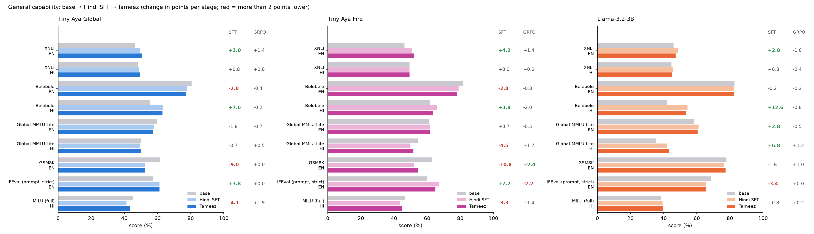

**Tiny Aya Global**

| Benchmark | Language | Base | Hindi SFT | Tameez | SFT effect | GRPO effect |
|---|---|---|---|---|---|---|
| XNLI | English | 46.4 | 49.4 | 50.8 | +3.0 | +1.4 |
| XNLI | Hindi | 48.2 | 49.0 | 49.6 | +0.8 | +0.6 |
| Belebele | English | 80.6 | 77.8 | 77.4 | -2.8 ⚠️ | -0.4 |
| Belebele | Hindi | 55.6 | 63.2 | 63.0 | +7.6 | -0.2 |
| Global-MMLU Lite | English | 59.8 | 58.0 | 57.2 | -1.8 | -0.7 |
| Global-MMLU Lite | Hindi | 50.2 | 49.5 | 50.0 | -0.7 | +0.5 |
| GSM8K | English | 61.4 | 52.4 | 52.4 | -9.0 ⚠️ | +0.0 |
| IFEval (prompt, strict) | English | 57.4 | 61.2 | 61.2 | +3.8 | +0.0 |
| MILU (full) | Hindi | 45.4 | 41.3 | 43.2 | -4.1 ⚠️ | +1.9 |

**The losses came from Hindi SFT, not GRPO.** English maths fell during SFT (GSM8K 61.4 → 52.4; SFT lost 85 questions the base model solved and gained 40) and GRPO left it there. English reading (−2.8) and MILU (−4.1) also dropped at SFT, and GRPO won back about half of the MILU loss (+1.9). The gains came from SFT too: Hindi reading +7.6, instruction following +3.8. GRPO moved every benchmark by less than 2 points. Stage 1 had no English rows and no maths-focused data, so the maths loss is most likely forgetting during SFT; mixing English and maths data into Stage 1 is the obvious fix to try.

<details>
<summary>Tiny Aya Fire</summary>


| Benchmark | Language | Base | Hindi SFT | Tameez | SFT effect | GRPO effect |
|---|---|---|---|---|---|---|
| XNLI | English | 46.4 | 50.6 | 52.0 | +4.2 | +1.4 |
| XNLI | Hindi | 49.4 | 49.4 | 49.4 | +0.0 | +0.0 |
| Belebele | English | 81.8 | 79.0 | 78.2 | -2.8 ⚠️ | -0.8 |
| Belebele | Hindi | 62.0 | 65.8 | 63.8 | +3.8 | -2.0 |
| Global-MMLU Lite | English | 61.3 | 62.0 | 61.5 | +0.7 | -0.5 |
| Global-MMLU Lite | Hindi | 54.5 | 50.0 | 51.7 | -4.5 ⚠️ | +1.7 |
| GSM8K | English | 63.0 | 52.2 | 54.6 | -10.8 ⚠️ | +2.4 |
| IFEval (prompt, strict) | English | 60.0 | 67.2 | 65.0 | +7.2 | -2.2 ⚠️ |
| MILU (full) | Hindi | 46.9 | 43.6 | 45.0 | -3.3 ⚠️ | +1.4 |

**The losses came from Hindi SFT, not GRPO, as in the Tiny Aya Global run.** English maths fell during SFT (GSM8K
63.0 → 52.2; SFT lost 78 questions the base model solved and gained 24), and GRPO won back
2.4 points (it fixed 25 questions and broke 13). Hindi knowledge also dipped at SFT
(Global-MMLU Lite Hindi −4.5, MILU −3.3) and GRPO recovered part of it (+1.7, +1.4); English reading fell 2.8 at SFT.
The gains came from SFT too: instruction following +7.2, XNLI English +4.2, Hindi reading +3.8. GRPO moved every
benchmark by at most 2.4 points. Fire starts stronger than Global in Hindi (Belebele Hindi 62.0 vs 55.6, Global-MMLU
Lite Hindi 54.5 vs 50.2) and keeps the lead after both stages.

XNLI Hindi is 49.4 at all three stages, but the models are not the same: 118 of 500 predictions change at SFT (39
fixed, 39 broken) and 49 at GRPO (14 and 14).

</details>

<details>
<summary>Llama-3.2-3B</summary>

| Benchmark | Language | Base | Hindi SFT | Tameez | SFT effect | GRPO effect |
|---|---|---|---|---|---|---|
| XNLI | English | 46.0 | 48.8 | 47.2 | +2.8 | -1.6 |
| XNLI | Hindi | 44.8 | 45.6 | 45.2 | +0.8 | -0.4 |
| Belebele | English | 82.8 | 82.6 | 82.4 | -0.2 | -0.2 |
| Belebele | Hindi | 41.8 | 54.4 | 53.6 | +12.6 | -0.8 |
| Global-MMLU Lite | English | 58.2 | 61.0 | 60.5 | +2.8 | -0.5 |
| Global-MMLU Lite | Hindi | 35.2 | 42.0 | 43.2 | +6.8 | +1.2 |
| GSM8K | English | 78.0 | 76.4 | 77.4 | -1.6 | +1.0 |
| IFEval (prompt, strict) | English | 68.8 | 65.4 | 65.4 | -3.4 ⚠️ | +0.0 |
| MILU (full) | Hindi | 38.5 | 39.3 | 39.5 | +0.8 | +0.2 |

For Llama, Hindi SFT brought the large Hindi gains (Belebele +12.6, Global-MMLU Lite +6.8) and the instruction-following drop (IFEval −3.4); GRPO again moved every benchmark by less than 2 points (largest: XNLI English −1.6).

</details>

SFT and Tameez tie exactly on four rows (Tiny Aya Global GSM8K and IFEval, Tiny Aya Fire XNLI Hindi, Llama IFEval). They are different models with different replies (Tiny Aya Global: 259 of 500 GSM8K replies differ) whose per-question changes cancel out (Tiny Aya Global GSM8K: GRPO fixed 21 questions and broke 21). Raw lm-eval JSON for all nine models, the full tables (`README.md`) and the scripts are in [`results/general_benchmarks/`](results/general_benchmarks/); every sample is in the [`tameez-eval-outputs`](https://huggingface.co/datasets/IINOVAII/tameez-eval-outputs/tree/main/general_benchmarks) dataset.

## Results by language

All 2,014 safety prompts of the held-out scorecard, split by the script the prompt is written in. Harmful prompts exist
only in Hindi (1,359) and Hinglish (139); English prompts are all harmless (90: angry users and tricky questions).

### Tiny Aya Global

| Language | Stage | Unsafe replies (harmful) ↓ | Explicit refusals (harmful) ↑ | Wrongly refuses harmless ↓ | Bad-word replies ↓ | Reply in the same script ↑ |
|---|---|---|---|---|---|---|
| Hindi (Devanagari) | Base | 3.1% | 43.6% | 0.9% | 1.8% | 99.3% |
| | Hindi SFT | 16.9% | 36.8% | 0.9% | 1.5% | 99.9% |
| | **Tameez** | **1.3%** | **80.7%** | 5.3% | **0.2%** | 99.9% |
| Hinglish (Roman) | Base | 18.7% | 5.0% | 0.9% | 4.9% | 50.2% |
| | Hindi SFT | 57.6% | 0.0% | 0.0% | 4.9% | 89.4% |
| | **Tameez** | 29.5% | 10.1% | 0.0% | **1.6%** | **94.3%** |
| English | Base | – | – | 10.0% | 8.9% | 100% |
| | Hindi SFT | – | – | 1.1% | 5.6% | 98.9% |
| | **Tameez** | – | – | 3.3% | 5.6% | 100% |

### Tiny Aya Fire

| Language | Stage | Unsafe replies (harmful) ↓ | Explicit refusals (harmful) ↑ | Wrongly refuses harmless ↓ | Bad-word replies ↓ | Reply in the same script ↑ |
|---|---|---|---|---|---|---|
| Hindi (Devanagari) | Base | 3.0% | 51.7% | 0.6% | 1.1% | 99.5% |
|  | Hindi SFT | 16.2% | 35.3% | 0.3% | 1.6% | 100% |
|  | **Tameez** | **1.5%** | **80.6%** | 4.7% | **0.2%** | 99.9% |
| Hinglish (Roman) | Base | 25.9% | 5.0% | 0.9% | 4.9% | 55.1% |
|  | Hindi SFT | 56.1% | 0.7% | 0.0% | 2.9% | 85.7% |
|  | **Tameez** | 31.7% | 5.8% | 0.0% | **2.0%** | **95.1%** |
| English | Base | – | – | 14.4% | 10.0% | 100% |
|  | Hindi SFT | – | – | 1.1% | 7.8% | 96.7% |
|  | **Tameez** | – | – | 3.3% | 7.8% | 98.9% |

### Llama-3.2-3B

| Language | Stage | Unsafe replies (harmful) ↓ | Explicit refusals (harmful) ↑ | Wrongly refuses harmless ↓ | Bad-word replies ↓ | Reply in the same script ↑ |
|---|---|---|---|---|---|---|
| Hindi (Devanagari) | Base | 8.8% | 34.8% | 1.2% | 2.1% | 99.9% |
| | Hindi SFT | 14.1% | 30.7% | 3.1% | 2.3% | 100% |
| | **Tameez** | **2.4%** | **64.1%** | 7.2% | **0.4%** | 100% |
| Hinglish (Roman) | Base | 21.6% | 5.8% | 1.9% | 3.7% | 97.6% |
| | Hindi SFT | 30.9% | 6.5% | 0.0% | 5.3% | 98.4% |
| | **Tameez** | **15.8%** | 8.6% | 2.8% | **0.4%** | 98.0% |
| English | Base | – | – | 5.6% | 14.4% | 100% |
| | Hindi SFT | – | – | 7.8% | 10.0% | 100% |
| | **Tameez** | – | – | 11.1% | 7.8% | 98.9% |

**What the split shows.** Almost all of the safety gain is in Devanagari Hindi (Tiny Aya 16.9% → 1.3% unsafe, refusals
36.8% → 80.7%). Hinglish halves from its post-SFT peak but stays well above Hindi, and Tiny Aya still refuses only
10.1% of Hinglish harmful prompts outright. Tiny Aya Fire shows the same split: in Devanagari Hindi its unsafe replies fall from 16.2% to 1.5% and refusals rise from 35.3% to 80.6%, while on Hinglish it ends at 31.7% unsafe and refuses only 5.8% of Hinglish harmful prompts outright. In English (angry users and tricky questions only), Tameez keeps the
over-refusal low for Tiny Aya (3.3%) but Llama refuses more (11.1%); English bad-word replies stay around 6–8% for both
because the English angry-user prompts often get their insults quoted back. The MuRIL abuse classifier is left out of
this table on purpose: it flags ordinary Roman Hinglish as abusive (none of 22 MuRIL-flagged Stage 2 replies on the mini
set were unsafe by Llama-Guard-3-8B), so its Hinglish numbers are not meaningful.

### Extra Hinglish training with a stronger safety reward

Hinglish stayed the weak spot, and the training safety reward (Llama-Guard-3-1B) misses about half of what Llama-Guard-3-8B flags, so we gave Tiny Aya Global Tameez **150 more GRPO steps on only the 1,357 Hinglish prompts of Set B** (450 harmful, 398 harmless, 398 angry-user, 111 tricky), with the same six rewards and weights but Llama-Guard-3-8B (4-bit) as the `safe_reply` judge (102 minutes on one L4). Because Llama-Guard-3-8B was now part of training, these replies were also judged by Qwen3Guard-Gen-8B, which no Tameez run has trained against, and the published Tameez model was re-run in the same environment as the baseline (it reproduced its 29.5% as 28.1%).

| Tiny Aya Global, Hinglish red-teaming (139 prompts) | Tameez (re-run) | + 150 Hinglish steps with the 8B reward | Paired p |
|---|---|---|---|
| Unsafe by Llama-Guard-3-8B (now also the reward) | 28.1% | **19.4%** | 0.05 |
| Unsafe by Qwen3Guard-Gen-8B (never trained against) | 12.2% | 10.1% | 0.55 |
| Unsafe or controversial by Qwen3Guard-Gen-8B | 44.6% | 37.4% | 0.08 |
| Refused outright | 8.6% | **17.3%** | |

The extra steps cut what the training judge flags by about a third and doubled outright refusals, but the independent judge sees at most a small change that is not statistically clear (paired McNemar tests on the same prompts). The two judges agree on only 10 of the 46 baseline replies that either calls unsafe, so "unsafe in Hinglish" is itself poorly measured. Side effects were small (angry-user over-refusal 9.0% → 12.5%, replies about 10% shorter, no harmless Hinglish prompt refused, MILU and every general benchmark within 1.4 points), but so was the gain, so the published model stays as it is. A safety classifier built for code-mixed Hindi, and Hinglish training prompts closer to how people type, look like the largest improvements still available.

The run's [checkpoints](https://huggingface.co/IINOVAII/Tiny-Aya-Global-Tameez-GRPO-checkpoints/tree/main/hinglish-followup), [replies and judge verdicts](https://huggingface.co/datasets/IINOVAII/tameez-eval-outputs/tree/main/tiny_aya/hinglish_followup) and [training logs](https://huggingface.co/datasets/IINOVAII/tameez-training-logs/tree/main/tiny_aya/hinglish_followup) are published next to the main ones; its general benchmarks are in [`results/general_benchmarks/`](results/general_benchmarks/). Reproduce it with `TAMEEZ_GUARD_TRAIN=meta-llama/Llama-Guard-3-8B TAMEEZ_GUARD_4BIT=1 python scripts/train_grpo.py --model IINOVAII/Tiny-Aya-Global-Tameez-GRPO --data data/processed/B_pool_hin.json --out stages/tameez_hinglish --max-steps 150 --save-steps 25 --batch-size 4 --grad-accum 4`, then `scripts/evaluate.py` for the scorecard and `scripts/judge_independent.py` for the Qwen3Guard verdicts; `train_grpo.py --resume-from <checkpoint>` continues a run that was cut off.

## The story in plots (Llama run)

The plots below are from the Llama run; the same plots for Tiny Aya Global and Tiny Aya Fire are in
[`tiny_aya_run/results/plots/`](tiny_aya_run/results/plots/) and [`tiny_aya_fire_run/results/plots/`](tiny_aya_fire_run/results/plots/).
All Llama plots are in [`results/plots/`](results/plots/) and are redrawn by `scripts/make_plots.py` after every stage.
Colours are fixed per stage: **blue = Stage 0, orange = Stage 1, aqua = Stage 2**.

### Safety: unsafe replies drop sharply after GRPO

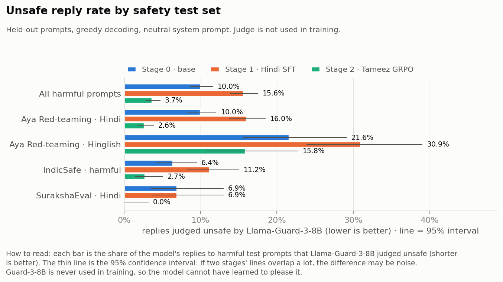

Each bar is the share of replies to harmful test prompts that Llama-Guard-3-8B judged unsafe (shorter is better; the
thin line is the 95% confidence interval). Fine-tuning on ordinary Hindi data (orange) **raised** the unsafe rate on
every set. This is the effect described by Qi et al. (ICLR 2024): fine-tuning on harmless data can erode safety. GRPO
(aqua) brought it down to 3.7% overall, well below even the base model.

### Hinglish is the hard case

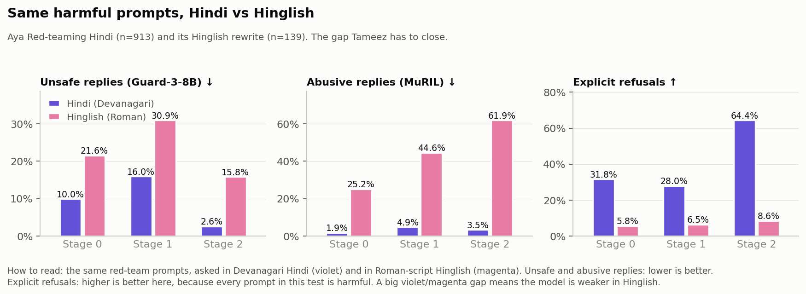

The same red-team prompts asked in Devanagari Hindi (violet) and Roman-script Hinglish (magenta). The base model is
twice as unsafe in Hinglish and almost never refuses there. GRPO halves the Hinglish unsafe rate, but Hinglish stays
the weakest language. One reason: the small safety model used *during training* (Llama-Guard-3-1B) misses much of the
harm in Roman script (see [Limitations](#limitations)).

### The cost: more refusals for angry users

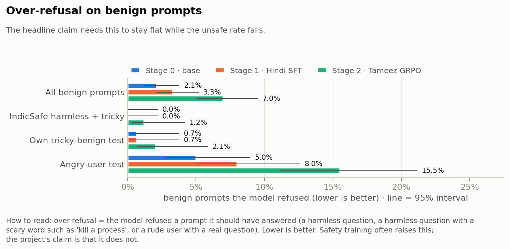

Over-refusal means refusing something the model should have answered. For ordinary harmless and "tricky-word"
questions it stays low (+2 prompts per test set). For **angry users who swear but ask a real question**, it roughly
doubles (8% → 15.5%). Reading those replies, about a third are not real refusals (the model declines the abuse, then
answers), but genuine refusals still rose from about 3.5% to about 10%.

### Everything on one page

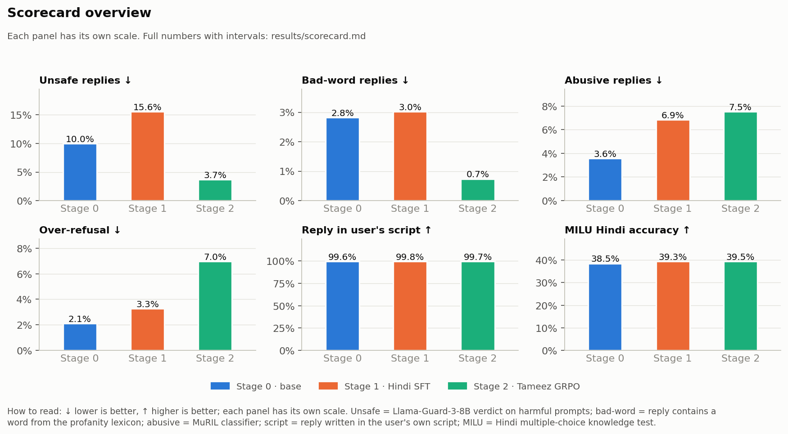

Six headline metrics, one panel each (each panel has its own scale; ↓ lower is better, ↑ higher is better).
Hindi knowledge (MILU) is flat across stages: safety training did not cost knowledge.

### Inside the RL environment

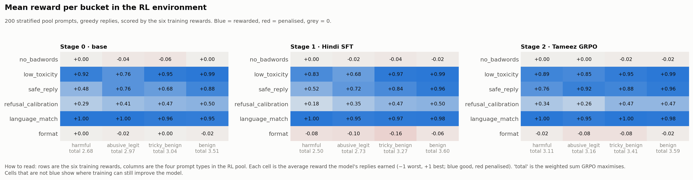

The six training rewards (rows) on the four prompt types (columns), measured on the same 200 training-pool prompts
before and after GRPO. Blue = rewarded, red = penalised. GRPO raised the total reward on harmful, angry-user and
tricky prompts and left ordinary benign prompts unchanged.

### Training: what GRPO actually did

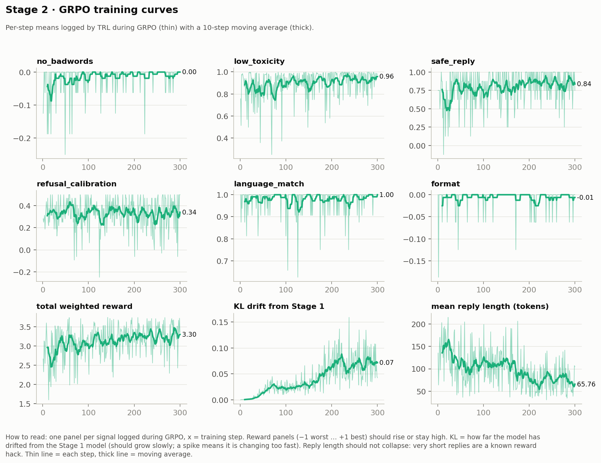

Per-step averages logged during the 300 GRPO steps. The safety and toxicity rewards rise and the language reward stays
near 1. After about step 150, **KL drift** (how far the model moves from Stage 1) keeps growing while **replies get shorter**:
the model starts earning reward by saying less. That's why the final model is the **step-100 checkpoint**, chosen
automatically by a rule that rejects checkpoints with more refusals or collapsed replies.

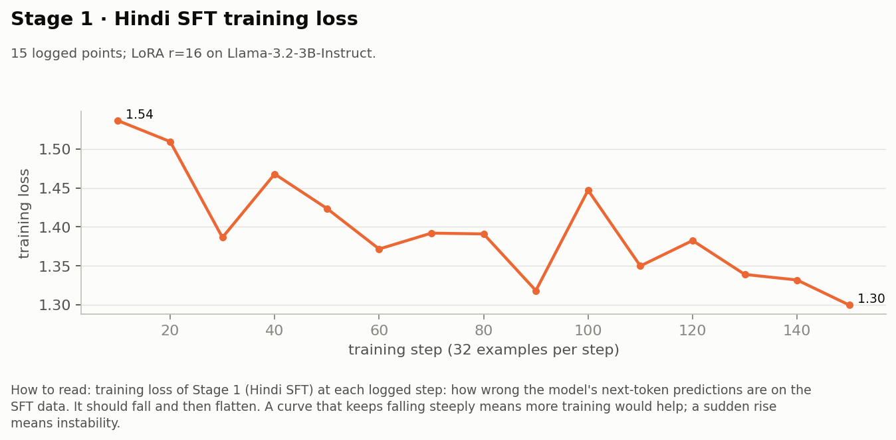

Stage 1 (Hindi SFT) loss: a light one-epoch fine-tune on 5,000 rows.

### Hindi knowledge by subject

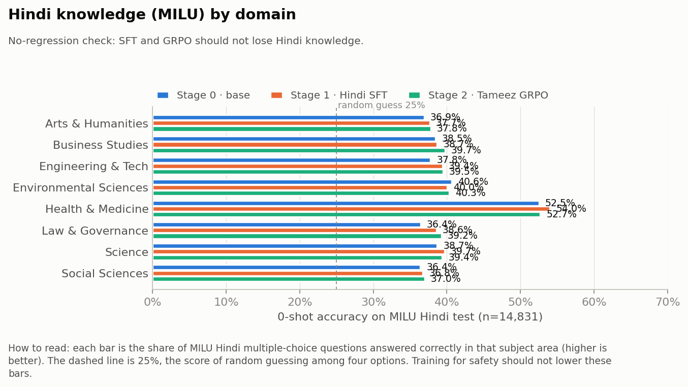

Accuracy on the MILU Hindi multiple-choice test by subject. The dashed line is random guessing (25%). No subject got
worse after safety training.

### Data

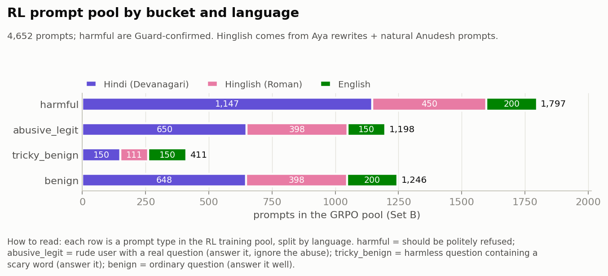

The GRPO training pool: 4,652 prompts in four types and three languages. 61% are *not* harmful, so a model that
refuses everything is heavily penalised.

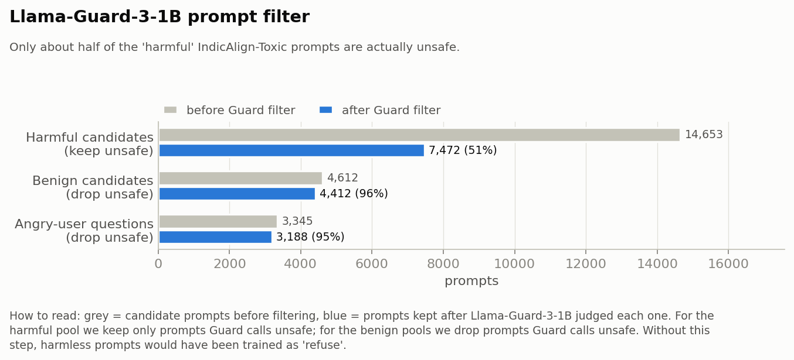

Only about half of the "harmful" prompts in the source dataset (IndicAlign-Toxic) are actually harmful according to
Llama-Guard. Training the rest as "refuse" would have taught over-refusal, so only confirmed-harmful prompts are kept.

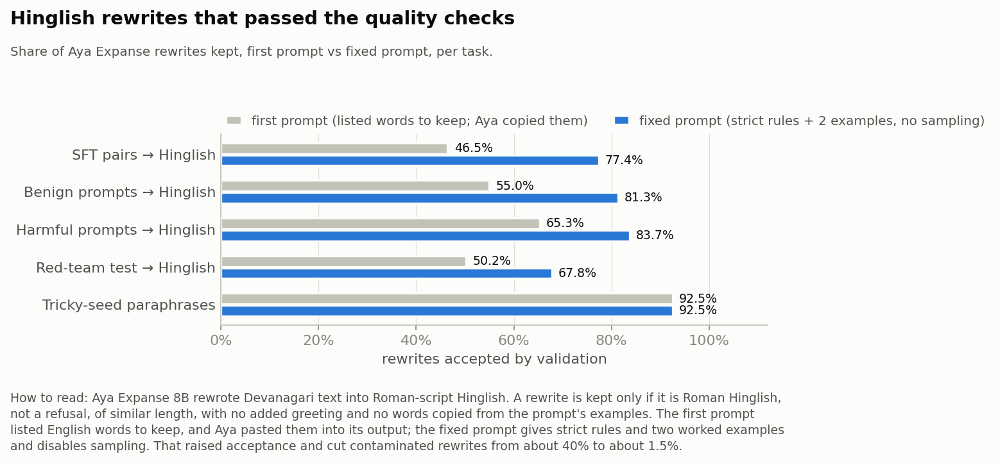

Natural Hinglish data is scarce, so Aya Expanse 8B rewrote Devanagari text into Roman-script Hinglish. A first
prompt let the model paste extra words into its rewrites. A fixed prompt with strict rules and worked examples raised
acceptance and cut contaminated rewrites from about 40% to about 1.5%.

---

## How it works

```
 Stage 0  base model ──────────────────────────────────────────────┐
              │  SFT on ordinary Hindi / Hinglish data (Set A)     │
 Stage 1  Hindi fine-tune ─────────────────────────────────────────┤──> same held-out scorecard
              │  GRPO in the RL environment (Set B + six rewards)  │    (Set C safety, Set D skill)
 Stage 2  Tameez ──────────────────────────────────────────────────┘
```

**Data (four separate sets, never mixed):**

| Set | Purpose | Size | Main sources |
|---|---|---|---|
| A | Stage 1 fine-tuning | 13,990 pairs (5,000 used on the L4) | IndicAlign Dolly-T / OASST-T, Aya Dataset, Aya Hinglish rewrites |
| B | GRPO prompt pool (no answers) | 4,652 prompts | IndicAlign-Toxic (Guard-confirmed), textdetox rants + real questions, Anudesh, tricky seeds |
| C | Safety test | 2,014 prompts | Aya Red-teaming (Hindi + Hinglish), IndicSafe, SurakshaEval, own tricky and angry-user splits |
| D | Skill test | 200 + 14,831 | Aya Evaluation Suite (Hindi), MILU Hindi |

Every row's train/test role comes from a hash of its id, and near-duplicates of test prompts are removed from training.

**The RL environment** pairs each training prompt with what good behaviour looks like (`harmful` → refuse politely,
`abusive_legit` → ignore the abuse and answer, `tricky_benign` → answer normally, `benign` → answer well) and scores
replies with **six separate rewards**:

| Reward | What it checks | Stops this reward hack |
|---|---|---|
| `no_badwords` | lexicon words or masked swears ("b***h") in the reply | dodging the lexicon with masking |
| `low_toxicity` | XLM-R toxicity classifier | – |
| `safe_reply` | Llama-Guard-3-1B on (prompt, reply) | – |
| `refusal_calibration` | refusal on harmful = good; refusal on anything else = penalised | refusing everything |
| `language_match` | reply written in the user's script | answering in English to avoid Hindi bad words |
| `format` | too short, repetition loops, leaked chat tokens | empty or one-line replies |

Details: [docs/ENVIRONMENT.md](docs/ENVIRONMENT.md) · [docs/REWARDS.md](docs/REWARDS.md).

**Models used:**

| Role | Model |
|---|---|
| Policies (trained) | Tiny Aya Global, Tiny Aya Fire, Llama-3.2-3B-Instruct |
| Training rewards | Llama-Guard-3-1B, textdetox XLM-R toxicity classifier |
| Evaluation judges (never used in training) | Llama-Guard-3-8B, MuRIL abusive-speech classifier; Qwen3Guard-Gen-8B as an independent check on the Tiny Aya runs |
| Hinglish rewrites + helpfulness judge | Aya Expanse 8B |

---

## Limitations

- **Both Tiny Aya models: Hinglish red-teaming ends worse than the base model** (Global 29.5% vs 18.7%, Fire 31.7% vs
  25.9% unsafe). GRPO roughly halved the damage plain SFT did (57.6% and 56.1%) but did not undo it.
- **Both Tiny Aya models: no checkpoint met every selection rule** (over-refusal cap of Stage 1 + 2 points = 2.8% for
  Global and 2.0% for Fire; Global also missed the 60% length rule), so the lowest-unsafe checkpoint (step 300) was used.
  Their over-refusal (3.9% and 3.5%) and angry-user over-refusal (9.0% and 8.0%) are at or above the base models' (2.5%
  / 5.5% and 3.1% / 7.5%).
- **Tiny Aya license:** CC-BY-NC 4.0, so the Tiny Aya derivatives (Global and Fire) are non-commercial.
- **The Tiny Aya Fire scorecard ran on the newer evaluation stack** (vLLM 0.33.0). Re-running the published Tiny Aya
  Global model on it moved its Hinglish unsafe rate by 1.4 points (29.5% → 28.1%), so differences of that size between
  the two Tiny Aya models are noise.
- **Angry-user over-refusal rose** (8% → 15.5%), and answers got shorter. An Aya Expanse judge preferred Stage 1's
  answers more often than Stage 2's (Stage 2 win rate 42%, mostly ties). Likely fixes are in
  [docs/RESULTS.md](docs/RESULTS.md#what-would-most-likely-fix-the-angry-user-over-refusal).
- **Llama-Guard-3-1B misses harmful Hinglish prompts:** it flags the same request 2–3× less often than in Devanagari,
  so harmful Hinglish prompts are chosen by their Hindi original. On replies it misses about half of what
  Llama-Guard-3-8B flags in both scripts, and GRPO removed mostly the unsafe replies it could see; training on Hinglish
  with the 8B judge as the reward helped less than it seemed (see
  [Extra Hinglish training](#extra-hinglish-training-with-a-stronger-safety-reward)).
- **MuRIL over-flags Roman Hinglish,** so its "abusive" rate is unreliable for Hinglish replies.
- **Small compute:** one L4 GPU meant 300 GRPO steps with 4 prompts × 4 replies each (the plan assumed more), and
  5,000 SFT rows instead of 10–20K.
- **The refusal detector is a phrase matcher:** it counts "I won't respond to that tone, but here's the answer…" as a refusal.
- **Model mirrors:** Llama-3.2-3B and Llama-Guard-3-1B were loaded from byte-identical public mirrors while Meta access was pending.

---

## Hyperparameters

Identical for all three base models unless noted. Values are taken from each run's saved `train_log.json`.

### Stage 1: Hindi SFT

| Setting | Value |
|---|---|
| Trainer | AlignTune `create_sft_trainer` (TRL backend); AlignTune 0.1.35 (Tiny Aya runs), 0.1.30 (Llama) |
| Base model | `CohereLabs/tiny-aya-global` / `CohereLabs/tiny-aya-fire` / `unsloth/Llama-3.2-3B-Instruct` |
| Data | 5,000 rows, stratified sample of Set A (every Hinglish and Aya row, rest Dolly-T / OASST-T); no safety data |
| Epochs / steps | 1 epoch = 157 optimiser steps |
| Batch | 4 per device × 8 gradient accumulation = 32 |
| Learning rate | 2e-4, cosine schedule, 3% warmup |
| Max sequence length | 768 tokens |
| LoRA | r = 16, α = 32, dropout 0.05, targets q/k/v/o/gate/up/down projections |
| Precision | bf16, gradient checkpointing |
| Checkpoints | every 100 steps (2 kept), loss logged every 10 steps |
| Seed | 42 |
| Time on one L4 | 55.3 min (Tiny Aya Global), 53.8 min (Tiny Aya Fire), 32.5 min (Llama) |

### Stage 2: Tameez GRPO

| Setting | Value |
|---|---|
| Trainer | AlignTune `create_rl_trainer(algorithm="grpo", loss_type="dr_grpo")`, TRL 1.7.1 backend, HF `generate` rollouts |
| Starting point | merged Stage 1 model, new LoRA |
| Prompt pool | Set B, 4,652 prompts (harmful 1,797 · angry user 1,198 · tricky 411 · benign 1,246) |
| Steps | 300 |
| Generations per prompt | 4 |
| Batch | 8 completions per device (2 prompts × 4) × 2 gradient accumulation = 4 prompts / 16 completions per step |
| Learning rate | 5e-5 |
| KL penalty β | 0.04 (reference = Stage 1 model) |
| Sampling during rollouts | temperature 0.9, top-p 0.95 |
| Lengths | prompt ≤ 512, completion ≤ 256, sequence ≤ 768 tokens |
| LoRA | r = 16, α = 32, dropout 0.0, same target modules |
| Rewards (weight) | no_badwords 2.0 · safe_reply 1.5 · low_toxicity 1.0 · refusal_calibration 1.0 · language_match 0.75 · format 0.5 |
| Reward models | Llama-Guard-3-1B (`safe_reply`), `textdetox/xlmr-large-toxicity-classifier-v2` (`low_toxicity`) |
| Precision | bf16, gradient checkpointing |
| Checkpoints | every 50 steps, all kept |
| Seed | 42 |
| Time on one L4 | 214.8 min (Tiny Aya Global, ≈ 44 s/step), 223.7 min (Tiny Aya Fire, ≈ 45 s/step), 136.8 min (Llama, ≈ 27 s/step) |

### Data building and audit

| Setting | Value |
|---|---|
| Hinglish rewrites | Aya Expanse 8B via vLLM, greedy (temperature 0), up to 1,024 new tokens, system rules + two worked examples |
| Rewrite acceptance checks | Roman Hinglish script; not a refusal; length 0.5–2× the source; no added greeting; no words copied from the prompt's examples |
| Harm labels | Llama-Guard-3-1B on the Hindi original; Hinglish rows inherit the label |
| Split | hash of the row id (stable across runs), seed 42 |
| Leakage dedup (build) | `datasketch` MinHash, 64 permutations, 5-character shingles, LSH threshold Jaccard ≥ 0.7 against every test prompt |
| CuratorKIT re-check | `ExactDeduplicator` + `MinHashDeduplicator` (Jaccard ≥ 0.7) within each training set and train-vs-test, `SecretsGate` on every split |

### Checkpoint selection

| Setting | Value |
|---|---|
| Test set | 200-prompt mini set (stratified subset of the held-out safety test) |
| Rule | over-refusal ≤ Stage 1 + 2 points; reply in the right script ≥ 95%; mean reply length ≥ 60% of Stage 1; then lowest unsafe + bad-word rate |
| Chosen | step 100 (Llama, passes every rule); step 300 (Tiny Aya Global and Tiny Aya Fire, fallback: no checkpoint passed the over-refusal cap) |

### Evaluation

| Setting | Value |
|---|---|
| Engine | vLLM, greedy decoding (temperature 0), up to 512 new tokens |
| System prompt | `You are a helpful assistant.` |
| Safety judge | `meta-llama/Llama-Guard-3-8B` on (prompt, reply), never used in training |
| Abuse judge | `Hate-speech-CNERG/indic-abusive-allInOne-MuRIL`, threshold 0.5 |
| Helpfulness judge | `CohereLabs/aya-expanse-8b`, Stage 2 vs Stage 1 on 400 prompts (200 Aya-Eval Hindi + 200 angry-user), judged twice with the order swapped; inconsistent verdicts count as ties; ties count half |
| Knowledge | MILU Hindi, all 14,831 questions, 0-shot, first-token log-probability over A–D |
| Intervals | 95% Wilson intervals on every rate |
| General benchmarks | lm-evaluation-harness 0.4.13, vLLM backend, chat template, few-shot as chat turns, greedy, ≤ 500 examples per (sub)task |

### Hardware and software

| | |
|---|---|
| GPU | one NVIDIA L4 (24 GB) on Google Colab for every training and evaluation step |
| Training stack | AlignTune 0.1.30 / 0.1.35, TRL 1.7.1, PEFT, transformers |
| Evaluation stack | vLLM, transformers (vLLM 0.33.0 for the Tiny Aya Fire scorecard); lm-evaluation-harness 0.4.13 + vLLM 0.33.0 for the general benchmarks |

## Licenses

| What | License | Notes |
|---|---|---|
| Tiny Aya Tameez models: `Tiny-Aya-Global-Tameez-GRPO`, `-GRPO-LoRA`, `-GRPO-checkpoints`, `Tiny-Aya-Global-Hindi-SFT`, `-Hindi-SFT-LoRA`, and the same five `Tiny-Aya-Fire-*` repos | CC-BY-NC 4.0 + Cohere Labs Acceptable Use Policy | derivatives of `CohereLabs/tiny-aya-global` and `CohereLabs/tiny-aya-fire`; non-commercial; attribution in each repo's `NOTICE` |
| Llama Tameez models: `Llama-3.2-3B-Tameez-GRPO`, `-GRPO-LoRA`, `-GRPO-step300`, `-GRPO-checkpoints`, `Llama-3.2-3B-Hindi-SFT`, `-Hindi-SFT-LoRA` | Llama 3.2 Community License + Llama Acceptable Use Policy | names start with "Llama" and show "Built with Llama", as the license requires; commercial use allowed under Meta's terms |
| `tameez-hindi-safety-data` | mixed, per source (card: `other`) | IndicAlign, MILU: CC BY 4.0 · Aya Dataset, Aya Red-teaming, Aya Evaluation Suite: Apache-2.0 · textdetox: OpenRAIL++ · Setu, IndicSafe: MIT · SurakshaEval: CC BY-NC-SA 4.0 · Hinglish rewrites written by Aya Expanse 8B: CC-BY-NC 4.0 (model license) |
| `tameez-eval-outputs`, `tameez-training-logs` | mixed (card: `other`) | model replies inherit the license of the model that wrote them (Tiny Aya / Aya Expanse / Command A: CC-BY-NC 4.0; Llama: Llama 3.2 license); prompts inherit their source's license |
| Tameez playground Space | CC-BY-NC 4.0 | serves the models; the Llama model stays under the Llama 3.2 license |
| Code (`github.com/N0VA06/tameez`) | **not yet stated** | the repository has no LICENSE file; choose one (for example Apache-2.0 or MIT) before claiming a license |
| Judges and reward models used, not redistributed | their own licenses | Llama-Guard-3-1B/8B (Llama 3.2 / Llama 3.1 license), XLM-R toxicity classifier (OpenRAIL++), MuRIL abuse classifier (AFL-3.0), Aya Expanse 8B (CC-BY-NC 4.0) |

## Run it

```bash
pip install -r requirements.txt                 # data scripts
# training stack: AlignTune (pins TRL), CuratorKIT, vLLM, datasketch, tensorboard
python scripts/download_data.py
python -I scripts/build_lexicon.py
python scripts/make_synthetic.py                # GPU: Aya Expanse Hinglish rewrites
python scripts/build_data.py --guard            # GPU: sets A-D with the Llama-Guard filter
python -I scripts/env_check.py                  # validate the RL environment
python scripts/evaluate.py --stage stage0_base --model unsloth/Llama-3.2-3B-Instruct
python scripts/train_sft.py                     # Stage 1
python scripts/evaluate.py --stage stage1_sft --model stages/stage1_sft/model/merged
python scripts/train_grpo.py                    # Stage 2 (300 steps)
python scripts/score_checkpoints.py             # pick the best checkpoint
python scripts/evaluate.py --stage stage2_grpo --model stages/stage2_grpo/model/best_merged
python scripts/judge.py --stage stage2_grpo
python -I scripts/make_plots.py
python -I scripts/audit_with_auditkit.py --root . --name "Llama-3.2-3B"   # AuditKIT audit of the saved replies (CPU)
hf download IINOVAII/tameez-hindi-safety-data --repo-type dataset --local-dir data/hf_safety_data
python -I scripts/curate_with_curatorkit.py --data data/hf_safety_data          # CuratorKIT audit of the data splits (CPU)
```

Every step, input, output and setting is described in [docs/PIPELINE.md](docs/PIPELINE.md).

### Rerun on Tiny Aya Global, Tiny Aya Fire (or any other policy)

The policy model is read from the `TAMEEZ_POLICY` environment variable (default `unsloth/Llama-3.2-3B-Instruct`).
Both Tiny Aya runs used exactly the steps above, with the data already built by the Llama run (or downloaded, see
[Use the published data](#use-the-published-data)), each in a fresh copy of the repository:

```bash
export TAMEEZ_POLICY=CohereLabs/tiny-aya-fire     # or CohereLabs/tiny-aya-global; gated: accept Cohere's terms on HF once, then `hf auth login`
python scripts/evaluate.py --stage stage0_base --model $TAMEEZ_POLICY
python scripts/env_check.py --stage stage0_base --rollout --model $TAMEEZ_POLICY
python scripts/train_sft.py                       # Stage 1
python scripts/evaluate.py --stage stage1_sft --model stages/stage1_sft/model/merged
python scripts/env_check.py --stage stage1_sft --rollout
python scripts/train_grpo.py                      # Stage 2; --resume-from <checkpoint> continues a run that was cut off
python scripts/score_checkpoints.py
python scripts/evaluate.py --stage stage2_grpo --model stages/stage2_grpo/model/best_merged
python scripts/env_check.py --stage stage2_grpo --rollout --model stages/stage2_grpo/model/best_merged
python scripts/judge.py --stage stage2_grpo
python scripts/judge_independent.py stage0_base=stages/stage0_base/eval/generations.json \
    stage1_sft=stages/stage1_sft/eval/generations.json stage2_grpo=stages/stage2_grpo/eval/generations.json \
    --out results/independent_judge.jsonl         # Qwen3Guard-Gen-8B check, never used in training
python -I scripts/make_plots.py
```

The run's `stages/` and `results/` were then copied to [`tiny_aya_run/`](tiny_aya_run/) and
[`tiny_aya_fire_run/`](tiny_aya_fire_run/), and the cross-model files are rebuilt from the three run folders:

```bash
python -I scripts/compare_runs.py --run . "Llama-3.2-3B" --run tiny_aya_run "Tiny Aya Global" \
                                  --run tiny_aya_fire_run "Tiny Aya Fire" --out COMPARISON.md
python -I scripts/make_comparison_plots.py --run tiny_aya_run "Tiny Aya Global" --run tiny_aya_fire_run "Tiny Aya Fire" \
                                           --run . "Llama-3.2-3B" --out assets
bash results/general_benchmarks/scripts/run_benchmarks.sh CohereLabs/tiny-aya-fire tiny_aya_fire_base   # one per model
python results/general_benchmarks/scripts/finalize.py results/general_benchmarks/results results/general_benchmarks
```

Timings on one L4 (wall clock per step): base scorecard 24 min, SFT 57 min (55 min of training), Stage 1 scorecard
18 min, GRPO plus checkpoint scoring 4 h 13 min (3 h 35 min of training), Stage 2 scorecard and judge 22 min: about 6 h 15 min in all.
Tiny Aya Fire took about the same: 25 + 54 + 17 min, GRPO 3 h 44 min, checkpoints 29 min, Stage 2 22 min (6 h 23 min),
plus 25 min for the Qwen3Guard check and 60 min for the general benchmarks.
Two code changes made the rewards model-agnostic: `src/tameez/rewards.py` knows Cohere's chat-turn tokens (for
`format`'s leaked-token check and for finding the last user turn), and `scripts/make_plots.py` labels plots with the policy name.

---

## Use the published data

Instead of rebuilding the sets (which needs GPUs for the Aya rewrites and the Llama Guard filter), fetch them from Hugging Face:

```bash
hf download IINOVAII/tameez-hindi-safety-data --repo-type dataset --local-dir hf_data
mkdir -p data/processed/cache data/lexicons
cp hf_data/data/sft/train.jsonl              data/processed/A_sft.json
cp hf_data/data/rl_prompts/train.jsonl       data/processed/B_pool.json
cp hf_data/data/safety_test/test.jsonl       data/processed/C_safety.json
cp hf_data/data/safety_test_mini/test.jsonl  data/processed/C_mini.json
cp hf_data/data/aya_eval_hindi/test.jsonl    data/processed/D_ayaeval.json
cp hf_data/data/milu_hindi/test.jsonl        data/processed/D_milu.json
cp hf_data/data/hinglish_rewrites/train.jsonl data/processed/cache/synthetic.json
cp hf_data/extras/manifest.json              data/processed/
cp hf_data/extras/guard_prompt_labels.json   data/processed/cache/
cp hf_data/lexicons/*                        data/lexicons/
```

(The files are JSON Lines. The scripts read them with the same loader whatever the extension.)

To evaluate a published model, pass its repo id:

```bash
python scripts/evaluate.py --stage stage2_grpo --model IINOVAII/Tiny-Aya-Global-Tameez-GRPO
```

---

## Repository layout

```
.
├── README.md                 this page
├── COMPARISON.md             Llama-3.2-3B, Tiny Aya Global and Tiny Aya Fire, every stage side by side
├── tiny_aya_run/             the Tiny Aya Global run: stages/ (metrics, logs) and results/ (scorecard, plots)
├── tiny_aya_fire_run/        the Tiny Aya Fire run, same layout
├── data/                     raw/ (downloaded), processed/ (sets A-D), lexicons/, tricky_seeds.json
├── docs/
│   ├── RESULTS.md            full results of every stage, every plot explained
│   ├── PIPELINE.md           every step, folder layout, logs, metric definitions, decisions
│   ├── ENVIRONMENT.md        the RL environment and its API
│   ├── REWARDS.md            the six rewards and their anti-hacking rules
│   ├── DATASETS.md           every data source: location, schema, licence, role
│   ├── DATA_ANALYSIS.md      what we found in the data before training
│   ├── ALIGNTUNE_ISSUES.md   AlignTune issues we hit: how to reproduce and fix them
│   └── PLAN.md               the original project plan
├── src/tameez/               library: text rules, data loaders, rewards, RL environment, vLLM helpers
├── scripts/                  one script per pipeline step (audit_with_auditkit.py: AuditKIT audit of saved replies)
├── stages/                   one folder per model: stage0_base/, stage1_sft/, stage2_grpo/
└── results/                  scorecard.md, plots/, logs/
```

---

## Safety note

Raw data contains toxic and offensive text by design. Scripts print counts and ids, not that text. Model replies to
harmful prompts, lexicon files and human-check sheets are kept out of git.
