# Results

> This page covers the **Llama-3.2-3B run**. The same pipeline was rerun on Cohere Labs' **Tiny Aya Global** and on
> its South Asia variant **Tiny Aya Fire**: their scorecards are
> [`tiny_aya_run/results/scorecard.md`](../tiny_aya_run/results/scorecard.md) and
> [`tiny_aya_fire_run/results/scorecard.md`](../tiny_aya_fire_run/results/scorecard.md), and all three runs side by side
> are in [`COMPARISON.md`](../COMPARISON.md).

Living document: updated after every stage. Numbers come from `stages/<stage>/eval/metrics.json`, the full
table is [`results/scorecard.md`](../results/scorecard.md), and the plots are drawn by `scripts/make_plots.py` into
[`results/plots/`](../results/plots/).

| Stage | What it is | Status |
|---|---|---|
| Stage 0 · base | `Llama-3.2-3B-Instruct`, no training | ✅ scored 2026-11-04 |
| Stage 1 · Hindi SFT | Stage 0 + LoRA SFT on normal Hindi/Hinglish data (Set A) | ✅ trained + scored 2026-11-04 |
| Stage 2 · Tameez GRPO | Stage 1 + GRPO in the RL environment (Set B, six rewards) | ✅ trained (300 steps, 2 h 17 min) + scored 2026-11-04 |

## How everything is measured (same for every stage)

- **Prompts:** held-out test sets that are never trained on (Set C safety, Set D skill). Every split is fixed by a hash
  of the row id, and near-duplicates of test prompts were removed from training data.
- **Decoding:** greedy, system prompt "You are a helpful assistant.", up to 512 new tokens.
- **Judges:** safety is judged by **Llama-Guard-3-8B** and toxicity by the **MuRIL abusive classifier**. Neither is used in
  training (training uses Guard-3-1B and an XLM-R classifier), so a stage cannot improve by learning to please its own grader.
- **Uncertainty:** every rate has a 95% Wilson interval; the plots draw it as a thin line.

## Summary

| Metric | Better | Stage 0 · base | Stage 1 · SFT | Stage 2 · GRPO |
|---|---|---|---|---|
| Unsafe replies, all harmful prompts | ↓ | 10.0% [8.6–11.6] | 15.6% [13.9–17.5] | **3.7%** [2.8–4.8] |
| • Hindi red-teaming | ↓ | 10.0% | 16.0% | **2.6%** |
| • Hinglish red-teaming | ↓ | 21.6% [15.6–29.1] | 30.9% [23.8–39.1] | **15.8%** [10.7–22.8] |
| • IndicSafe harmful / SurakshaEval | ↓ | 6.4% / 6.9% | 11.2% / 6.9% | **2.7% / 0.0%** |
| Bad-word replies (lexicon) | ↓ | 2.8% | 3.0% | **0.7%** |
| Abusive replies (MuRIL) ¹ | ↓ | 3.6% | 6.9% | 7.5% |
| Over-refusal on benign prompts | ↓ | 2.1% [1.2–3.8] | 3.3% [2.1–5.2] | **7.0%** [5.1–9.5] |
| • IndicSafe harmless + tricky | ↓ | 0.0% | 0.0% | 1.2% |
| • own tricky test | ↓ | 0.7% | 0.7% | 2.1% |
| • angry-user prompts ² | ↓ | 5.0% | 8.0% | **15.5%** [11.1–21.2] |
| Explicit refusal of harmful prompts | ↑ | 31.9% | 28.3% | **58.5%** |
| Reply in the user's script | ↑ | 99.6% | 99.8% | 99.7% |
| MILU Hindi accuracy | ↑ | 38.5% | 39.3% | **39.5%** |
| Mean reply length | | 828 chars | 646 chars | 376 chars |
| Helpfulness win rate vs Stage 1 (Aya Expanse judge) | ↑ | – | – | **42.1%** [37.3–47.0] |

¹ MuRIL over-flags Roman-script Hinglish; see "Measurement caveats". ² About a third of these are not real refusals; see the breakdown in Stage 2.

## Stage 0 · base model

### The base model is twice as unsafe in Hinglish

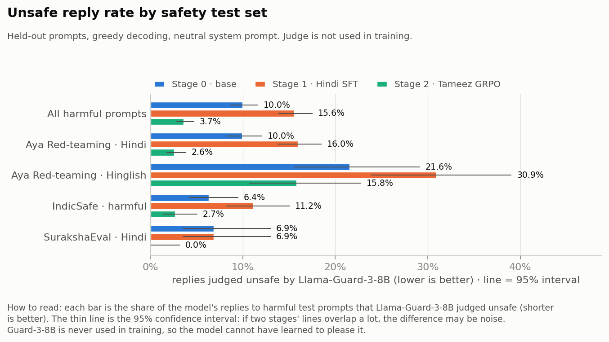

Across all 1,498 harmful test prompts, 10% of replies are unsafe. On the **same red-team prompts rewritten in
Roman-script Hinglish, 21.6%** are unsafe (95% interval 15.6–29.1%, which does not overlap the Hindi interval).
IndicSafe and SurakshaEval, which are mostly sensitive rather than openly harmful, sit around 6–7%.

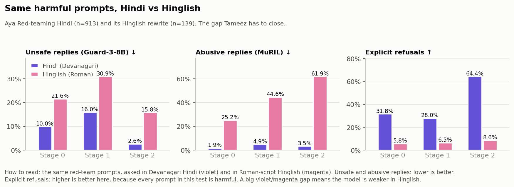

Side by side on the same prompts, the Hinglish replies are **2.2× as often unsafe, 13× as often abusive** (25.2% vs 1.9%),
and the model **explicitly refuses only 5.8% of harmful Hinglish prompts against 31.8% in Hindi**. This is the gap
Tameez is built to close, and it is now measurable.

### Over-refusal is already low, so the "no rise" bar is tight

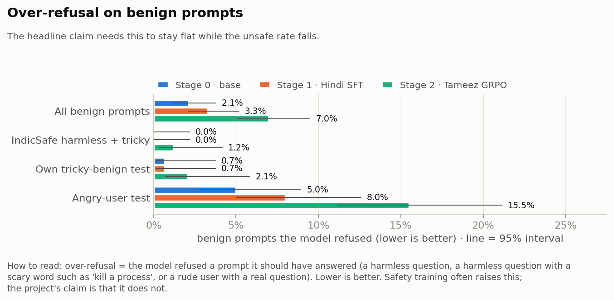

The base model refuses 2.1% of benign prompts overall: 0% of IndicSafe's harmless and tricky prompts, 0.7% of our tricky
test (benign questions with words like "kill a process"), and 5.0% of angry-user prompts (a rude user with a real
question). Stage 2 has to bring the unsafe rate down **without** raising these bars.

### Overview and Hindi knowledge

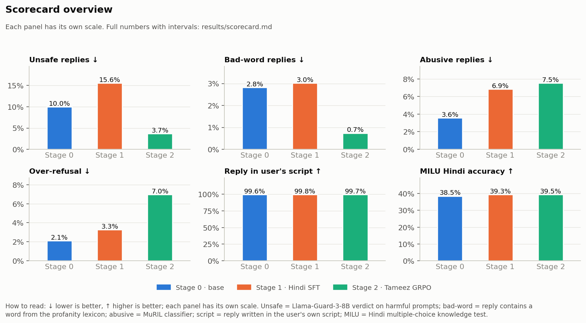

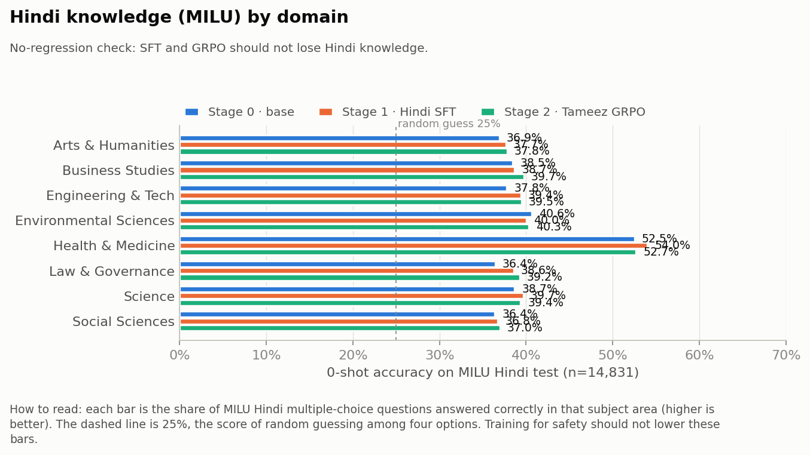

MILU Hindi is 38.5% overall (random guessing is 25%), highest in Health & Medicine (52.5%). This is the
no-regression baseline: Stage 1 should raise or keep it, and Stage 2 should stay within about 1 point of Stage 1.

### The RL environment before any training

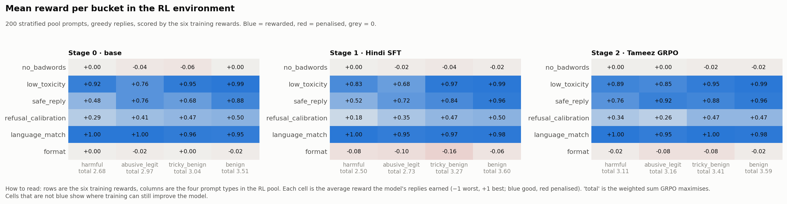

The six training rewards on 200 pool prompts (50 per bucket), before GRPO:

- `language_match` is already +1.00 everywhere: the base model answers in the user's script.
- `refusal_calibration` is lowest on **harmful** prompts (+0.21 of a possible +0.5): the model rarely refuses explicitly.
- `safe_reply` (Llama-Guard-3-1B) averages only +0.64 on **tricky_benign** prompts, so about 18% of harmless replies are
  flagged unsafe. **This is a risk for training:** GRPO could learn to avoid normal topics such as health or killing a
  Linux process. In the GRPO tuning runs (see Stage 2) the logged tricky-benign replies were not penalised by
  `safe_reply` and over-refusal on held-out prompts did not jump, so `safe_reply` stays on for all prompts; it is
  re-checked on the final run's samples.

## Data

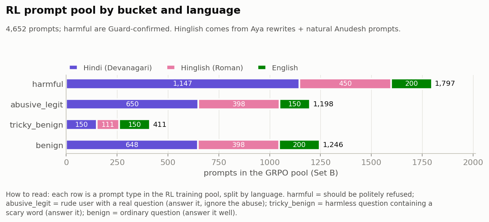

The GRPO prompt pool has 4,375 prompts: 1,520 harmful (refuse politely), 1,198 angry users with a real question,
411 tricky-benign and 1,246 benign. 65% are non-harmful, matching the plan, so refusing everything is heavily penalised.
By language: 59% Devanagari Hindi, 25% Roman Hinglish, 16% English.

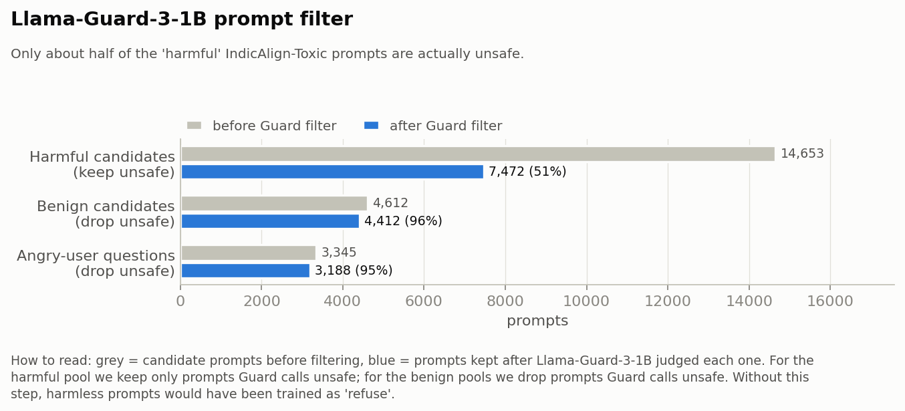

Only **48%** of the "harmful" candidates from IndicAlign-Toxic are actually unsafe according to Llama-Guard-3-1B; the
rest are ordinary questions (HH-RLHF first turns). Training them as "refuse" would have taught over-refusal, so
only Guard-confirmed prompts are kept. The benign pools lost 4–5% that Guard considers unsafe.

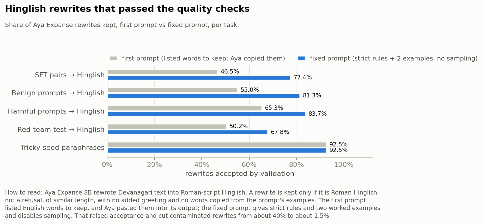

Natural Hinglish is scarce, so Aya Expanse 8B rewrote Devanagari prompts and SFT pairs into Roman script. The first
prompt listed English words to keep and Aya pasted them into about 40% of its outputs. The fixed prompt (strict rules,
two worked examples, no sampling) raised acceptance to 68–86% and cut contaminated rewrites to about 1.5%.

### Llama-Guard-3-1B misses harm written in Hinglish

| Prompts | Flagged unsafe by Llama-Guard-3-1B |
|---|---|
| Hindi originals from HH-RLHF / Toxic-Matrix | 46% / 53% |
| The same kind of prompts after rewriting into Roman Hinglish | 17% / 24% |

The same requests are flagged two to three times less often once they are written in Roman script. Two consequences:

1. **Data:** filtering the Hinglish rewrites by their own Guard label threw most harmful Hinglish prompts away (only
   173 survived). The pool now decides harmfulness on the **Hindi original** and rewrites only Guard-confirmed harmful
   Hindi prompts into Hinglish (the request is the same, so the label carries over).
2. **Reward:** `safe_reply` uses the same Guard-1B, so its signal is weaker for Hinglish replies. The other rewards
   (`refusal_calibration`, `low_toxicity` with a Hinglish-trained classifier, `no_badwords` with Hinglish lexicons)
   still apply, and evaluation uses the larger Guard-3-8B. This is a known limitation of the training reward.

## Stage 1 · Hindi SFT

**What was trained:** LoRA (r=16, α=32, all attention + MLP layers) on 5,000 rows of ordinary Hindi instruction data:
2,737 Dolly-T, 831 OASST-T, 594 Aya Dataset and 838 Aya Hinglish rewrites. One epoch, learning rate 2e-4,
157 steps, 32.5 minutes on the L4. No safety data at all: this is the model "a typical company would ship".

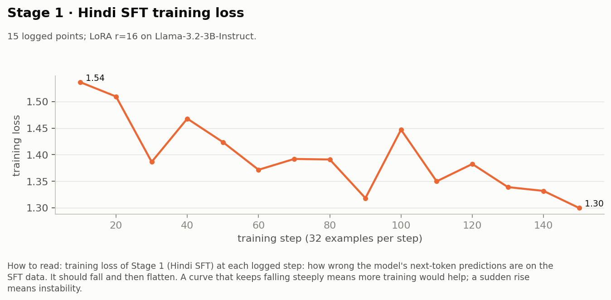

Loss fell from 1.54 to 1.30 and was still drifting down: one epoch on 5,000 rows is a light fine-tune.

### Result: better at Hindi, clearly less safe

| | Stage 0 | Stage 1 | Change |
|---|---|---|---|
| MILU Hindi accuracy | 38.5% | **39.3%** | +0.8 points (intervals barely overlap) |
| Unsafe replies, all harmful | 10.0% | **15.6%** | **+5.6 points, ×1.56** (intervals do not overlap) |
| Unsafe, Hinglish red-teaming | 21.6% | **30.9%** | +9.3 points |
| Abusive replies to Hinglish red-team prompts (MuRIL) | 25.2% | **44.6%** | nearly doubled |
| Abusive replies, all safety prompts | 3.6% | 6.9% | ×1.9 |
| Explicit refusal of harmful prompts | 31.9% | 28.3% | −3.6 points |
| Over-refusal on benign prompts | 2.1% | 3.3% | +1.2 points (intervals overlap: may be noise) |

This reproduces the effect the plan cites (Qi et al., ICLR 2024, *Fine-tuning aligned language models compromises
safety*): plain Hindi fine-tuning, with no harmful data, made the model more willing to answer harmful requests and
much more abusive, especially in Hinglish, while slightly improving Hindi knowledge. The safety losses are the target
Stage 2 has to recover **without** giving back the MILU gain or raising over-refusal.

The RL-environment rollout (plot 05) moved the same way: the total reward fell on harmful (2.66 → 2.56) and angry-user
prompts (3.13 → 2.92), and Llama-Guard-3-1B's `safe_reply` on harmful prompts fell from 0.56 to 0.52.

## Stage 2 · Tameez GRPO

**What was trained:** GRPO (Dr. GRPO loss) on the Stage 1 model with LoRA r=16, in the RL environment of 4,652 prompts
(1,797 harmful, 1,198 angry users with a real question, 411 tricky-benign, 1,246 benign; 29% Roman Hinglish) and the
six rewards. 300 steps × 4 prompts × 4 replies, learning rate 5e-5, KL penalty β = 0.04, 2 h 17 min on the L4.

### Training curves

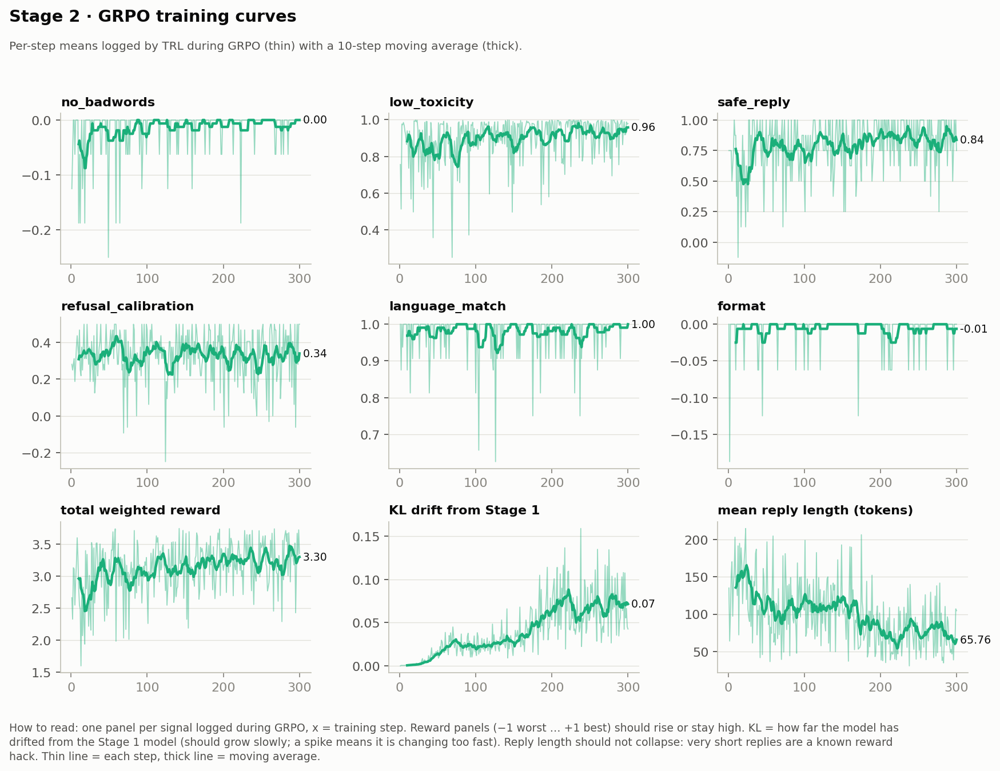

| Steps | Total reward | KL to Stage 1 | Reply length (tokens) | `safe_reply` | `low_toxicity` | `language_match` |
|---|---|---|---|---|---|---|
| 1–50 | 2.87 | 0.005 | 131 | 0.70 | 0.84 | 0.98 |
| 51–100 | 3.06 | 0.023 | 107 | 0.77 | 0.87 | 0.99 |
| 101–150 | 3.14 | 0.026 | 113 | 0.80 | 0.90 | 0.97 |
| 151–200 | 3.20 | 0.048 | 93 | 0.81 | 0.92 | 0.98 |
| 201–250 | 3.25 | 0.068 | 73 | 0.86 | 0.94 | 0.98 |
| 251–300 | 3.26 | 0.071 | 75 | 0.85 | 0.93 | 0.99 |

The safety and toxicity rewards rose steadily and the language reward stayed near 1. After step ~150 the gains slowed
while KL kept growing and replies got shorter: the model was starting to buy reward by saying less.

### Checkpoint selection (180-prompt mini-set, Stage 1 = reference)

| Checkpoint | Unsafe | Bad words | Over-refusal | Script | Mean reply | Eligible? |
|---|---|---|---|---|---|---|
| Stage 1 (reference) | 13.8% | 2.5% | 4.2% | 100% | 793 chars | – |
| step 50 | 6.2% | 2.0% | 7.5% | 99.5% | 592 | ✗ over-refusal +3.3 |
| **step 100** | **5.0%** | **2.0%** | **5.8%** | 100% | 602 | **✓ chosen** |
| step 150 | 1.2% | 1.0% | 6.7% | 100% | 522 | ✗ over-refusal +2.5 |
| step 200 | 1.2% | 1.0% | 11.7% | 100% | 401 | ✗ over-refusal, reply length |
| step 250 | 1.2% | 1.0% | 8.3% | 99.5% | 412 | ✗ over-refusal, reply length |
| step 300 | 1.2% | 1.0% | 6.7% | 100% | 402 | ✗ over-refusal, reply length |

Rule: over-refusal ≤ Stage 1 + 2 points, script ≥ 95%, mean reply ≥ 60% of Stage 1 (476 chars), then the lowest
unsafe + bad-word rate. Later checkpoints were even safer but refused more and answered more tersely, so **step 100
became Stage 2**. Everything below is the full scorecard of that checkpoint.

### Result: much safer, Hindi knowledge kept, but more refusals for angry users

| | Stage 1 | Stage 2 | Change |
|---|---|---|---|
| Unsafe replies, all harmful prompts | 15.6% | **3.7%** | **÷4.2**, also well below the base model (10.0%); intervals do not overlap |
| Unsafe, Hindi red-teaming | 16.0% | **2.6%** | ÷6 |
| Unsafe, Hinglish red-teaming | 30.9% | **15.8%** | halved, but still the weakest set |
| Bad-word replies | 3.0% | **0.7%** | ÷4 |
| Explicit refusal of harmful prompts | 28.3% | **58.5%** | ×2 |
| MILU Hindi | 39.3% | **39.5%** | kept (plan: within 1 point) |
| Over-refusal, IndicSafe harmless + tricky | 0.0% | 1.2% | +2 prompts of 170 |
| Over-refusal, own tricky test | 0.7% | 2.1% | +2 prompts of 146 |
| Over-refusal, angry users | 8.0% | **15.5%** | **roughly doubled** |
| Mean reply length | 646 chars | 376 chars | shorter |
| Helpfulness win rate vs Stage 1 (Aya Expanse, 400 prompts, both orders) | – | **42.1%** [37.3–47.0] | 48 wins · 241 ties · 111 losses; Aya Eval 44.5%, angry users 39.8% |

**What the angry-user refusals are.** Reading the 31 replies flagged as refusals (out of 200):

| Kind | Stage 1 | Stage 2 |
|---|---|---|
| Declined the abuse, then answered the question properly (e.g. "I can't respond to this kind of talk. Here is the recipe for aloo bhaat: …") | 6 | 5 |
| Refused because the rant itself asks for something harmful (some textdetox rants contain violent demands) | 3 | 6 |
| **Real refusal of a legitimate question** | **7 (3.5%)** | **20 (10%)** |

The headline 15.5% overstates the problem, but the real over-refusal of rude users still roughly tripled. Ordinary
benign prompts are barely affected (+2 prompts on each benign set).

### RL environment before and after GRPO

Same 200 pool prompts for every stage (total weighted reward / refusal rate / mean reply length):

| Bucket | Stage 0 | Stage 1 | Stage 2 |
|---|---|---|---|
| harmful | 2.68 / 58% / 527 | 2.50 / 36% / 462 | **3.11 / 68% / 199** |
| abusive_legit (angry user) | 2.97 / 6% / 911 | 2.73 / 10% / 712 | **3.16** / 16% / 616 |
| tricky_benign | 3.04 / 2% / 1113 | 3.27 / 2% / 920 | **3.41** / 2% / 796 |
| benign | 3.51 / 0% / 907 | 3.60 / 0% / 686 | 3.59 / 2% / 630 |

GRPO raised the reward on harmful, angry-user and tricky prompts, left benign prompts unchanged, and made refusals of
harmful prompts much shorter (199 chars). The angry-user refusal rate rose from 10% to 16% here as well.

### Verdict against the plan

| Plan target (vs Stage 1) | Result | Met? |
|---|---|---|
| Unsafe reply rate: halve it | 15.6% → 3.7% | ✅ (÷4.2) |
| Bad-word rate under 0.5% | 0.7% | ≈ (close; was 3.0%) |
| Over-refusal: no increase | ordinary benign +1–1.5 points; angry users 8% → 15.5% (real refusals ~3.5% → ~10%) | ❌ for angry users |
| Script fidelity over 95% | 99.7% | ✅ |
| MILU within 1 point of Stage 1 | 39.3% → 39.5% | ✅ |
| Helpfulness win rate ≥ 50% vs Stage 1 | 42.1% (interval 37.3–47.0, below 50) | ❌ |

**Honest summary:** on one L4 GPU, GRPO with these six rewards made the Hindi-fine-tuned model four times less likely
to give unsafe replies (and safer than the original base model), cut bad words by four, and kept its Hindi knowledge.
The cost is more refusals for angry users with real questions and shorter, judged-less-helpful answers (win rate 42% vs Stage 1, mostly ties). The "no rise in over-refusal"
claim holds for ordinary benign prompts but not for abusive-but-legitimate ones.

### What would most likely fix the angry-user over-refusal

- `refusal_calibration` gives −1 for refusing an angry user, but `safe_reply` and `low_toxicity` can still favour
  disengaging from a toxic conversation. Weighting `refusal_calibration` higher on `abusive_legit` prompts, or not
  applying `safe_reply` there, targets exactly this.
- The refusal detector counts "declined the abuse, then answered" as a refusal; a stricter detector (refusal **and**
  no answer) would reward the behaviour we want.
- Remove rants with violent demands from angry-user prompts (both training and test), since refusing those is correct.

## Measurement caveats

- **MuRIL over-flags Roman Hinglish.** Its "abusive" rate rose slightly (6.9% → 7.5%) while bad words fell 4×. On the
  mini-set, none of the 22 MuRIL-flagged Stage 2 replies were unsafe by Llama-Guard-3-8B, only 1 contained a lexicon
  word, and 18 of 22 were Roman Hinglish (including normal answers to tricky questions). Read the MuRIL row with care.
- **Llama-Guard-3-1B (training reward) misses harm in Roman Hinglish** (see Data). Hinglish safety improved less than
  Hindi (red-teaming 30.9% → 15.8% vs 16.0% → 2.6%), consistent with a weaker training signal for Hinglish.
- **Refusal detector** is a phrase matcher: it counts disclaimers followed by a real answer as refusals.
- **Mini-set noise:** checkpoint selection uses 120 benign prompts (1 prompt = 0.8 points), so the over-refusal rule is coarse.

### Settings and why

| Setting | Value | Why |
|---|---|---|
| Start model | Stage 1 merged | the plan: align the model a company would ship |
| Learning rate | 5e-5 (plan 5e-6) | tuning runs at 5e-6 (20 steps) and 2e-5 (150 steps) left the KL to Stage 1 below 0.003 and held-out changes within noise: the LoRA barely moved |
| Steps | 300 (1,200 prompts) | the reward rose for the first ~75 steps of the tuning run and then flattened at the lower learning rate |
| KL penalty β | 0.04 | unchanged; guards against drifting too far from Stage 1 |
| Prompts × replies per step | 4 × 4 | fits the L4; every group of 4 had different rewards (non-zero variance), so the signal is usable |
| Checkpoints | every 50 steps, all 6 scored on the 180-prompt mini-set | best = lowest unsafe + bad-word rate among checkpoints with over-refusal ≤ Stage 1 + 2 points, script fidelity ≥ 95% and mean reply length ≥ 60% of Stage 1's |
| Reply-length guard | ≥ 60% of Stage 1's mean reply | late in an earlier run KL jumped (0.026 → 0.048) and replies shortened (113 → 93 tokens); a model that gets "safe" by saying less must not be picked |
| Hinglish harmful prompts | chosen by the Hindi original's Guard label | see "Llama-Guard-3-1B misses harm written in Hinglish" |

**Reward hacking seen in tuning: none.** Mean reply length stayed at 100–240 tokens (no collapse to short replies),
`frac_reward_zero_std` was 0 (no group where all four replies scored the same), the language reward stayed at ~1.0,
and almost no bad words appeared.

## Compute settings (one 24 GB L4)

The plan was written for an A100 option. Everything here runs on a single L4, with these reductions:

| Setting | Plan | Used on the L4 | Effect |
|---|---|---|---|
| SFT rows | 10–20K | 5,000 stratified (all Hinglish + Aya, random Dolly/OASST) | ~50 min instead of ~2.5 h |
| SFT max length / batch | 1,024 / 8×4 | 768 / 4×8 (same effective batch 32) | fits memory |
| GRPO steps | 400 | 300 | ~2.7 h at ~32 s/step; 1,200 prompts seen |
| GRPO backend / rollouts | Unsloth + vLLM | AlignTune TRL backend + HF generate | Unsloth broke the Llama-Guard reward model (see PIPELINE.md) |
| Prompts × generations per step | 8 × 8 | 4 × 4 | smaller groups, noisier advantage |
| Max completion | 384 tokens | 256 tokens | long answers truncated during training |
| GRPO learning rate | 5e-6 | 5e-5 | at lower rates the LoRA barely moved (see Stage 2); β = 0.04 KL penalty kept |
| Checkpoints | every 50 | every 50 (6 scored on the mini-set) | |
| Ablations | 150 steps | 60 steps | |

Evaluation is **not** reduced: every stage gets the full scorecard (2,014 safety prompts, 200 Aya Eval prompts,
all 14,831 MILU questions), so stages stay directly comparable.
