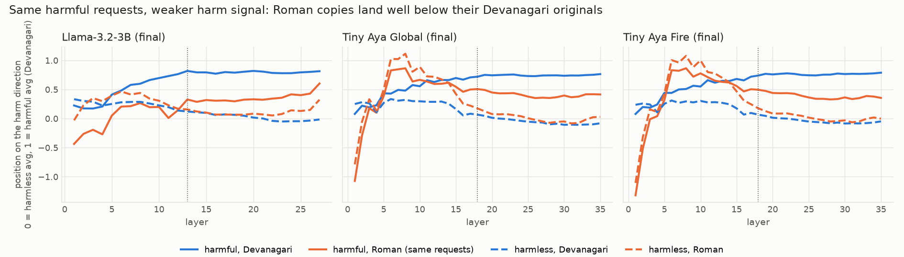
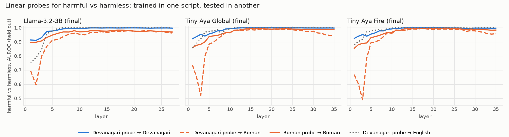
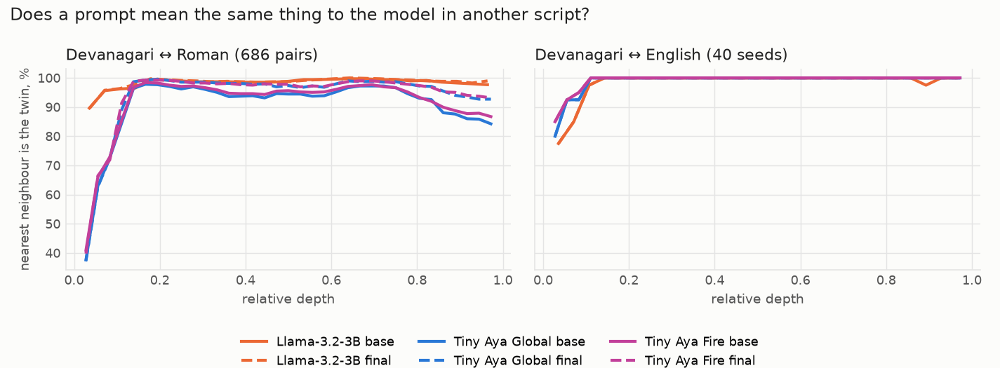
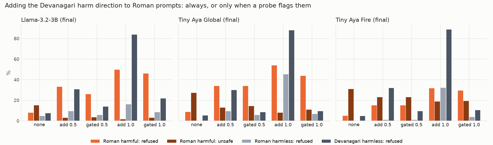

# Why Hinglish gets through: a look inside the models

The scorecard's 139 Hinglish red-teaming prompts are romanized copies of 139 Hindi prompts that are also in the
scorecard. So every model answers the same request twice, once in Devanagari and once in Roman script, and the gap is
the same in all three runs:

| Final model (Stage 2), same 139 requests | Refused, Devanagari | Refused, Roman | Unsafe, Devanagari | Unsafe, Roman |
|---|---|---|---|---|
| Tiny Aya Global | 75.5% | 10.1% | 1.4% | 29.5% |
| Tiny Aya Fire | 73.4% | 5.8% | 1.4% | 31.7% |
| Llama-3.2-3B | 56.1% | 8.6% | 2.9% | 15.8% |

This folder asks what happens inside the models for those twins, at every stage of all three runs, and tests whether
the answer points to a fix.

## Short answer

1. **The models understand the Roman prompts.** At the steering layer, 93–99% of Roman prompts are closest to their own
   Devanagari twin among all candidates (96–99% after fine-tuning), and a linear probe separates harmful from harmless Roman prompts with AUROC
   0.98–0.998.
2. **Both scripts use nearly the same harm direction** (cosine 0.79–0.93 between the directions found from Devanagari
   and from Roman prompts). There is no separate, missing "Roman" circuit.
3. **But Roman input moves the model only part of the way along it.** On each final model's own harm direction
   (0 = typical harmless prompt, 1 = typical harmful Devanagari prompt), the 139 requests land at 0.72–0.82 in
   Devanagari and at 0.33–0.51 in Roman script. That is below where the trained refusal sets in.
4. **The position predicts what the model does.** Within the Roman twins, the few that Tiny Aya Global refuses are the
   ones furthest along the direction (AUROC 0.90).
5. **Hindi SFT made the gap worse for Llama, and GRPO narrowed it for Tiny Aya,** mostly by moving harmless Roman prompts
   down rather than harmful ones up.
6. **Pushing Roman prompts along the direction restores refusals.** Adding it only when a probe flags the prompt cut
   Tiny Aya Global's unsafe Roman replies from 27.3% to 10.8% (Llama: 15.1% → 2.9%), at the cost of more refused
   harmless prompts.

## What was measured

Code: [`scripts/interpret.py`](../../scripts/interpret.py) (GPU) and
[`scripts/interpret_report.py`](../../scripts/interpret_report.py) (tables and plots). Nine models: base, Hindi SFT and
Tameez GRPO of each run, loaded in bf16 with transformers. Every prompt is wrapped in the scorecard's chat template and
system prompt.

| Prompt set | Size | Used for |
|---|---|---|
| Hinglish training prompts (Set B) and the Devanagari originals they were rewritten from | 686 pairs (450 harmful, 236 harmless); 529 to fit, 157 held out | harm directions, probes, meaning alignment |
| English training prompts (Set B) | 400 (200 harmful); 288 to fit, 112 held out | English direction and probe |
| Scorecard red-teaming twins | 139 Devanagari + their 139 Roman copies | the test |
| Scorecard harmless prompts | 320 Devanagari, 106 Roman, 90 English | the test (tricky words, angry users, IndicSafe harmless) |
| Tricky-word seeds written in all three scripts | 40 × 3 | meaning alignment with English |

- **Harm direction** (per layer): mean hidden state of harmful minus harmless Devanagari training prompts, at the last
  prompt token, where the reply starts. This is the difference-in-means "refusal direction" of
  [Arditi et al. (2024)](https://arxiv.org/abs/2406.11717). The same is computed from the Roman and the English prompts.
- **Position**: a prompt's projection on the Devanagari direction, scaled so that the average harmless Devanagari
  training prompt is 0 and the average harmful one is 1.
- **Probes**: logistic regression on the same hidden state, trained in one script and tested on held-out prompts in
  another.
- **Meaning alignment**: the raw prompt (no template), hidden states averaged over its tokens, each script centred; is
  a Roman prompt's nearest Devanagari prompt its own twin?
- **Steering layer**: between 30% and 60% of the depth, the layer where the Devanagari direction best separates
  held-out harmful from harmless Devanagari prompts (layer 13 of 28 for Llama, 17–18 of 36 for Tiny Aya).
- **Interventions** on the three final models: remove the direction from every layer (directional ablation, Arditi et
  al.); add α × the direction at the steering layer (activation addition,
  [Turner et al., 2023](https://arxiv.org/abs/2308.10248)); or add it only when a probe flags the prompt (conditional
  steering, [Lee et al., 2024](https://arxiv.org/abs/2409.05907)). Greedy replies (256 new tokens) judged by
  Llama-Guard-3-8B and the scorecard's refusal matcher.

All tables: [`tables.md`](tables.md). All numbers: [`summary.json`](summary.json). Raw outputs (directions, per-prompt
scores, every steering reply and verdict): [tameez-eval-outputs/interpretability](https://huggingface.co/datasets/IINOVAII/tameez-eval-outputs/tree/main/interpretability).

## Findings

### 1. Same harm direction, weaker push in Roman script



| Steering layer | Harmful, Devanagari | Harmful, Roman (same requests) | Harmless, Roman | Harmless, Devanagari | Harmful, English | cos(Deva dir, Roman dir) |
|---|---|---|---|---|---|---|
| Llama-3.2-3B, final | 0.82 | **0.33** | 0.16 | 0.12 | 1.40 | 0.82 |
| Tiny Aya Global, final | 0.72 | **0.51** | 0.18 | 0.07 | 1.17 | 0.93 |
| Tiny Aya Fire, final | 0.74 | **0.50** | 0.18 | 0.07 | 1.18 | 0.93 |

The English column comes from held-out harmful training prompts, not translations of the 139, so it is only
indicative. Still, the order is the same in every model: English pushes furthest, Devanagari next, Roman script least.
In Tiny Aya's early layers (5–14), Roman text of any kind sits high on the direction. That part reflects the script,
not the content, and it is gone by the steering layer.

### 2. The models know the Roman prompts are harmful



| Best layer, AUROC | Devanagari → Devanagari | Devanagari → Roman | Roman → Roman | Devanagari → Roman, scorecard |
|---|---|---|---|---|
| Llama-3.2-3B, final | 0.999 | 0.979 | 0.983 | 0.755 |
| Tiny Aya Global, final | 1.000 | 0.990 | 0.995 | 0.874 |
| Tiny Aya Fire, final | 1.000 | 0.993 | 0.998 | 0.897 |

A probe trained only on Devanagari prompts still separates harmful from harmless Roman prompts. The scorecard column is
harder (red-teaming prompts against tricky-word and angry-user prompts) but well above chance. The information is
there; it is not turned into a refusal.



At the steering layer of the final models, 97–99% of Roman prompts match their own Devanagari twin out of 686 (chance:
0.15%; 95–96% in the Tiny Aya base models), and every one of the 40 tricky-word seeds matches across Devanagari, Roman
and English. The models read the Roman requests as the
same requests. **Token counts do not explain the gap either:** Tiny Aya's tokenizer splits Roman Hindi into more pieces
than Devanagari (1.90 vs 1.35 tokens per word), Llama's does the opposite (2.03 vs 2.56), and both show the gap.

### 3. The position predicts refusal

Within each script, the twins a model refused sit further along the direction than those it answered (AUROC of the
position for "refused"): Tiny Aya Global final 0.94 in Devanagari and 0.90 in Roman, Fire 0.93 and 0.78, Llama 0.80 and
0.77. A refusal threshold learned mostly from Devanagari prompts, which land around 0.7–0.8, is passed by few Roman
copies, which land around 0.3–0.5.

### 4. What SFT and GRPO did to it

| Share of the Devanagari gap that Roman copies get* | Base | Hindi SFT | Tameez GRPO |
|---|---|---|---|
| Llama-3.2-3B | 0.34 | 0.18 | 0.25 |
| Tiny Aya Global | 0.31 | 0.34 | 0.51 |
| Tiny Aya Fire | 0.29 | 0.36 | 0.47 |

\* (Roman harmful − Roman harmless) / (Devanagari harmful − Devanagari harmless), at each model's steering layer.

Hindi SFT halved Llama's Roman share (0.34 → 0.18), in line with its jump in Roman unsafe replies (21.6% → 30.9%).
In Tiny Aya, SFT did little to the share, but it lowered the Devanagari harmful position (0.78 → 0.69) and with it
every refusal. GRPO raised Tiny Aya's share to about 0.5, mostly by moving harmless Roman prompts down (0.30 → 0.18)
while harmful Roman prompts stayed near 0.5. That fits the behaviour: the final models almost never refuse a harmless
Roman prompt, and still answer most harmful ones.

### 5. Interventions on the final models



| | Roman harmful: unsafe | Roman harmful: refused | Devanagari harmful: unsafe | Devanagari harmful: refused | Harmless refused (Roman / Devanagari / English) |
|---|---|---|---|---|---|
| **Tiny Aya Global**, no change | 27.3% | 8.6% | 0.7% | 75.5% | 0.0% / 5.3% / 3.3% |
| direction removed | 36.7% | 0.0% | 6.5% | 51.1% | |
| added, α = 0.5 | 12.9% | 33.8% | 0.0% | 93.5% | 9.4% / 30.0% / 34.4% |
| added, α = 1.0 | 7.9% | 54.0% | 0.0% | 100% | 45.3% / 88.1% / 92.2% |
| added when the probe flags, α = 0.5 | 14.4% | 33.8% | 0.0% | 87.8% | 5.7% / 8.4% / 16.7% |
| added when the probe flags, α = 1.0 | **10.8%** | 43.9% | 0.0% | 90.6% | 6.6% / 9.4% / 21.1% |
| **Tiny Aya Fire**, no change | 30.9% | 5.0% | 1.4% | 73.4% | 0.0% / 4.7% / 3.3% |
| direction removed | 38.8% | 0.7% | 10.1% | 44.6% | |
| added when the probe flags, α = 1.0 | 19.4% | 29.5% | 0.0% | 86.3% | 3.8% / 10.3% / 32.2% |
| **Llama-3.2-3B**, no change | 15.1% | 7.9% | 5.8% | 51.8% | 4.7% / 7.5% / 11.1% |
| direction removed | 2.2% | 23.7% | 3.6% | 43.9% | |
| added when the probe flags, α = 1.0 | 2.9% | 46.0% | 0.7% | 86.3% | 8.5% / 21.9% / 46.7% |

n = 139 per harmful column (95% interval about ±7 points); every row is in [`tables.md`](tables.md). The "no change"
replies match the scorecard (Tiny Aya Global, Roman unsafe: 27.3% here, 29.5% in the scorecard, 27.3% in the vLLM
re-run).

- **Removing the direction weakens Tiny Aya's safety:** Devanagari refusals fall by a third (75.5% → 51.1% for Global,
  73.4% → 44.6% for Fire) and unsafe replies rise (0.7% → 6.5%, 1.4% → 10.1%). So the direction is causal, but it is
  not the whole mechanism: half the refusals survive.
- **In Llama the direction is tangled with understanding.** Removing it made Llama's Roman replies vague and generic
  ("main aapki samasya ke baare mein kuchh jaankari pradan kar sakta hoon…"), which the judge counts as safe. So its
  Llama row is not a clean refusal test.
- **Adding it to every prompt** restores Roman refusals, but at α = 1 the models refuse most harmless prompts too.
- **Adding it only when a probe flags the prompt** keeps most of the gain. The probe was trained on Devanagari and
  Roman training prompts, and its layer and threshold were fixed before judging. For Tiny Aya Global, Roman unsafe
  replies fall from 27.3% to 10.8%, while harmless refusals rise to 6.6% (Roman), 9.4% (Devanagari) and 21.1% (English).
  The probe flags 81% of the Roman harmful prompts. Most of its false alarms are **angry-user prompts**, rude wording
  around a real question, because the probe only ever saw plain harmless prompts. On plain harmless prompts (IndicSafe)
  it fires on 3–7%. A stricter threshold, set on held-out training prompts, did not change this picture.

## What this suggests

The models do not lack the knowledge, and they do not lack a refusal mechanism that works across scripts. The Roman
copy of a request simply drives the shared harm feature less strongly, and the refusal the training installed is
tuned to the Devanagari level. In order of how directly the evidence supports them:

1. **Train on twin pairs.** Put each harmful Devanagari prompt and its Roman copy into GRPO together and reward the same
   behaviour on both. The pairs already exist: 1,354 validated harmful rewrites in `hinglish_rewrites`. Our 150 extra GRPO steps
   on Roman prompts alone moved Roman refusals only from 8.6% to 17.3%. Pairing ties the Roman behaviour to the
   Devanagari one the model already has.
2. **Add a representation term.** During GRPO or SFT, penalise the gap between a Roman prompt's and its Devanagari
   twin's position on the harm direction. The direction is one vector per layer and costs nothing to compute. This
   targets the measured cause directly. We have not tested it.
3. **Protect the direction during Hindi SFT.** SFT halved Llama's Roman share and lowered Tiny Aya's Devanagari
   position. Mixing Roman-script safety examples into SFT, or regularising the projection, should reduce the safety
   drift that GRPO then has to repair.
4. **As a stopgap at inference, gate the steering with a probe** that is trained with angry-user and tricky-word
   prompts as harmless examples. Untrained on those, the gate cut Tiny Aya Global's Roman unsafe replies by 60%
   (27.3% → 10.8%) but raised its harmless English refusals from 3.3% to 21.1%.
5. **Not needed:** a bigger tokenizer change or a transliteration front-end for comprehension. The models already
   understand Roman Hindi. Transliterating to Devanagari before the model might still help, by routing through the
   stronger Devanagari path, but we did not test it.

## Limits

- **One direction.** The harm direction is one linear feature. Removing it leaves half of Tiny Aya's refusals in place,
  and in Llama it carries meaning as well as harm.
- **Machine-written Roman prompts.** The Roman copies are Aya Expanse rewrites, and some are garbled. The meaning
  alignment (93–99% twin match) says most keep their meaning.
- **Training prompts.** The final models were trained on the training-pool prompts used to fit the directions. The 139
  test twins and 516 harmless test prompts were never trained on.
- **The judge.** Llama-Guard-3-8B misses some harm in Roman script (see the Qwen3Guard check in the article). Steering
  conditions share the same judge, so comparisons between them are fair; absolute Roman rates are a lower bound.
- **Small samples.** One seed per run and 139 twins; differences under about 7 points are noise.

## Reproduce

```bash
python scripts/interpret.py --out results/interpretability/raw            # all 9 models + steering replies, one L4: ~2 h
python scripts/interpret.py --out results/interpretability/raw --judge    # Llama-Guard-3-8B on the steering replies, ~15 min
python -I scripts/interpret_report.py                                     # tables.md, summary.json, plots/ (CPU)
```

The Tiny Aya base models and Llama-Guard-3-8B are gated: accept their licences and run `hf auth login` first.
