# Llama-3.2-3B run (first run, control)

Policy: [`unsloth/Llama-3.2-3B-Instruct`](https://huggingface.co/unsloth/Llama-3.2-3B-Instruct) (a byte-identical mirror of Meta's model). Final model: [IINOVAII/Llama-3.2-3B-Tameez-GRPO](https://huggingface.co/IINOVAII/Llama-3.2-3B-Tameez-GRPO) (GRPO step 100 of 300, the best checkpoint that passed every selection rule). The full stage-by-stage write-up of this run is [docs/RESULTS.md](../../docs/RESULTS.md).

## Results

| | Stage 0 · base model | Stage 1 · Hindi fine-tune | **Stage 2 · Tameez (GRPO)** |
|---|---|---|---|
| What it is | Llama-3.2-3B-Instruct, untouched | Stage 0 + ordinary Hindi instruction data | Stage 1 + safety RL with six rewards |
| Unsafe replies to harmful prompts ↓ | 10.0% | 15.6% | **3.7%** |
| … Hindi red-team prompts ↓ | 10.0% | 16.0% | **2.6%** |
| … Hinglish red-team prompts ↓ | 21.6% | 30.9% | **15.8%** |
| Replies with bad words ↓ | 2.8% | 3.0% | **0.7%** |
| Refuses harmful prompts ↑ | 31.9% | 28.3% | **58.5%** |
| Over-refusal, ordinary harmless prompts ↓ | 0–0.7% | 0–0.7% | 1.2–2.1% |
| Over-refusal, angry users with a real question ↓ | 5.0% | 8.0% | **15.5%** ⚠️ |
| Answers in the user's own script ↑ | 99.6% | 99.8% | 99.7% |
| Hindi knowledge (MILU, 14,831 questions) ↑ | 38.5% | 39.3% | **39.5%** |
| Helpfulness win rate vs Stage 1 (ties count ½) ↑ | – | – | 42% ⚠️ |

**In one sentence:** ordinary Hindi fine-tuning made the model *less* safe; Tameez GRPO made it **four times safer than
that, and safer than the original**, without losing Hindi knowledge, but it now refuses more rude-but-legitimate
requests and gives shorter answers.

## What is in this folder

| Path | What it is |
|---|---|
| [`scorecard.md`](scorecard.md) / [`scorecard.csv`](scorecard.csv) | every metric of every stage with 95% Wilson intervals |
| [`plots/`](plots/) | the result and training plots of this run ([index](plots/README.md)) |
| [`auditkit_report.md`](auditkit_report.md) | AuditKIT audit of the saved scorecard replies |
| `stages/stage0_base/eval/` | base model scorecard: `metrics.json`, `milu.json`, `eval_args.json` |
| `stages/*/env/` | the RL environment before and after training: `env_check.json`, `rollout_report.json` |
| `stages/stage1_sft/train/` | Stage 1 (Hindi SFT) training log |
| `stages/stage1_sft/eval/`, `eval_mini/` | Stage 1 scorecard, and Stage 1 on the 200-prompt mini set (the checkpoint-selection reference) |
| `stages/stage2_grpo/train/` | Stage 2 (Tameez GRPO) training log and reward-sample summary |
| `stages/stage2_grpo/checkpoints/` | every GRPO checkpoint scored on the mini set; `checkpoints.json` holds the selection |
| `stages/stage2_grpo/eval/`, `judge/` | the final scorecard, and the helpfulness judge (Stage 2 vs Stage 1) |

Replies to harmful prompts are kept out of git. Every reply, judge verdict and log of this run is on Hugging Face:
[tameez-eval-outputs/llama_3_2_3b](https://huggingface.co/datasets/IINOVAII/tameez-eval-outputs/tree/main/llama_3_2_3b) and
[tameez-training-logs/llama_3_2_3b](https://huggingface.co/datasets/IINOVAII/tameez-training-logs/tree/main/llama_3_2_3b).

## The story in plots

Colours are fixed per stage: **blue = Stage 0, orange = Stage 1, aqua = Stage 2**.

### Safety: unsafe replies drop sharply after GRPO

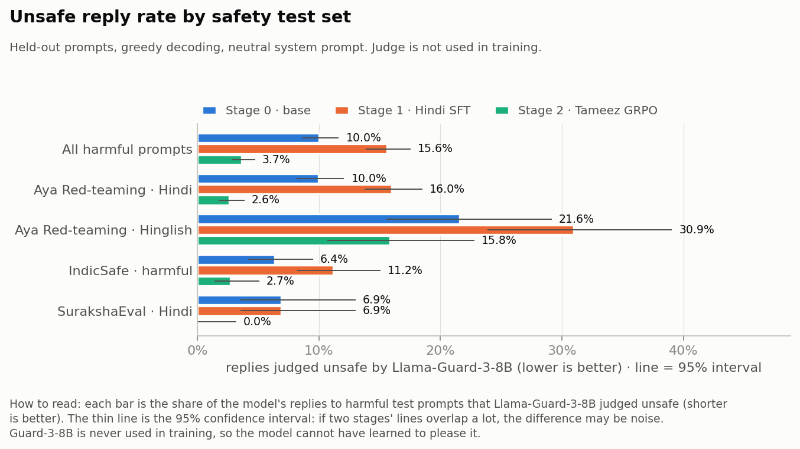

Each bar is the share of replies to harmful test prompts that Llama-Guard-3-8B judged unsafe (shorter is better; the
thin line is the 95% confidence interval). Fine-tuning on ordinary Hindi data (orange) **raised** the unsafe rate on
every set. This is the effect described by Qi et al. (ICLR 2024): fine-tuning on harmless data can erode safety. GRPO
(aqua) brought it down to 3.7% overall, well below even the base model.

### Hinglish is the hard case

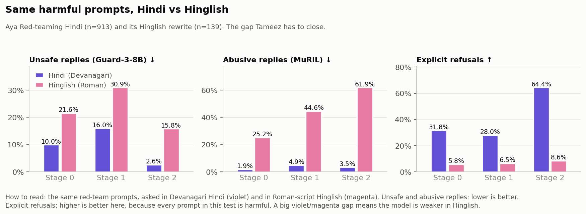

The same red-team prompts asked in Devanagari Hindi (violet) and Roman-script Hinglish (magenta). The base model is
twice as unsafe in Hinglish and almost never refuses there. GRPO halves the Hinglish unsafe rate, but Hinglish stays
the weakest language. One reason: the small safety model used *during training* (Llama-Guard-3-1B) misses much of the
harm in Roman script (see [Limitations](#limitations)).

### The cost: more refusals for angry users

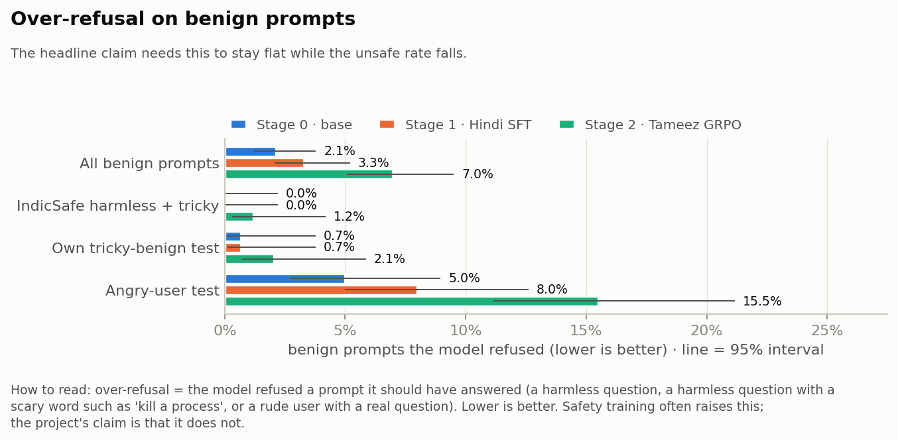

Over-refusal means refusing something the model should have answered. For ordinary harmless and "tricky-word"
questions it stays low (+2 prompts per test set). For **angry users who swear but ask a real question**, it roughly
doubles (8% → 15.5%). Reading those replies, about a third are not real refusals (the model declines the abuse, then
answers), but genuine refusals still rose from about 3.5% to about 10%.

### Everything on one page

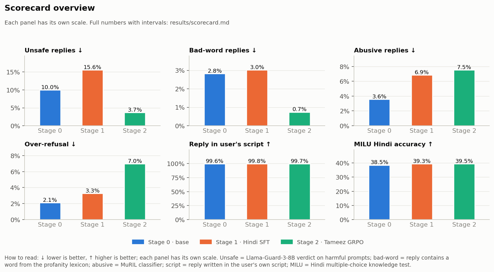

Six headline metrics, one panel each (each panel has its own scale; ↓ lower is better, ↑ higher is better).
Hindi knowledge (MILU) is flat across stages: safety training did not cost knowledge.

### Inside the RL environment

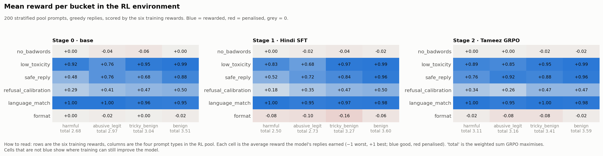

The six training rewards (rows) on the four prompt types (columns), measured on the same 200 training-pool prompts
before and after GRPO. Blue = rewarded, red = penalised. GRPO raised the total reward on harmful, angry-user and
tricky prompts and left ordinary benign prompts unchanged.

### Training: what GRPO actually did

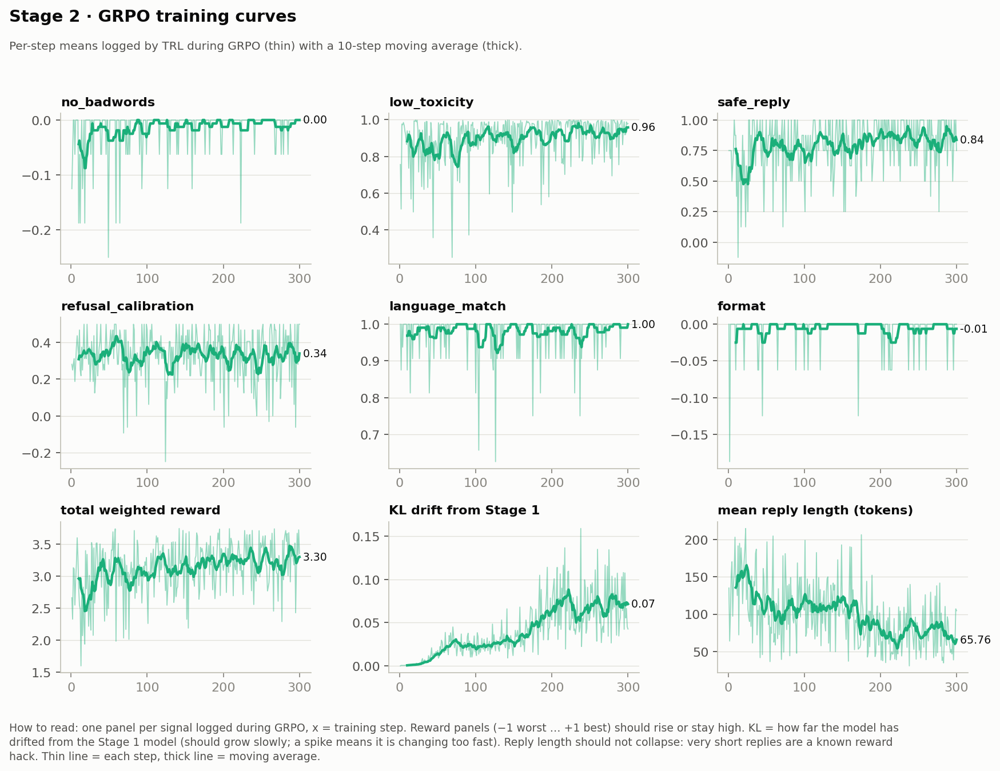

Per-step averages logged during the 300 GRPO steps. The safety and toxicity rewards rise and the language reward stays
near 1. After about step 150, **KL drift** (how far the model moves from Stage 1) keeps growing while **replies get shorter**:
the model starts earning reward by saying less. That's why the final model is the **step-100 checkpoint**, chosen
automatically by a rule that rejects checkpoints with more refusals or collapsed replies.

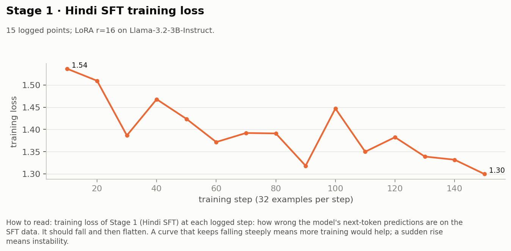

Stage 1 (Hindi SFT) loss: a light one-epoch fine-tune on 5,000 rows.

### Hindi knowledge by subject

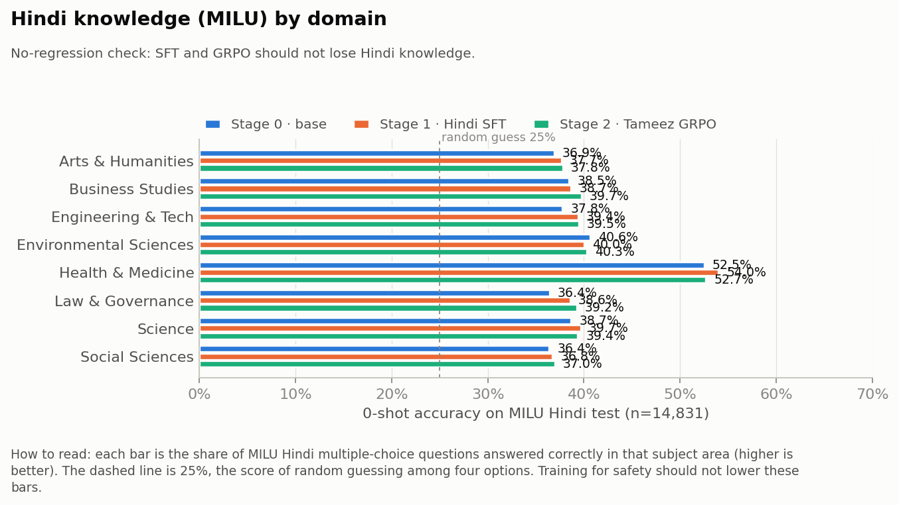

Accuracy on the MILU Hindi multiple-choice test by subject. The dashed line is random guessing (25%). No subject got
worse after safety training.

### Data

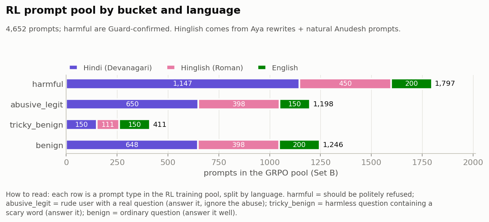

The GRPO training pool: 4,652 prompts in four types and three languages. 61% are *not* harmful, so a model that
refuses everything is heavily penalised.

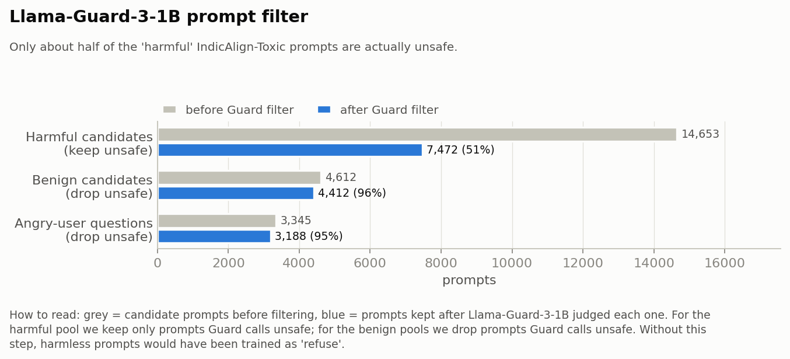

Only about half of the "harmful" prompts in the source dataset (IndicAlign-Toxic) are actually harmful according to
Llama-Guard. Training the rest as "refuse" would have taught over-refusal, so only confirmed-harmful prompts are kept.

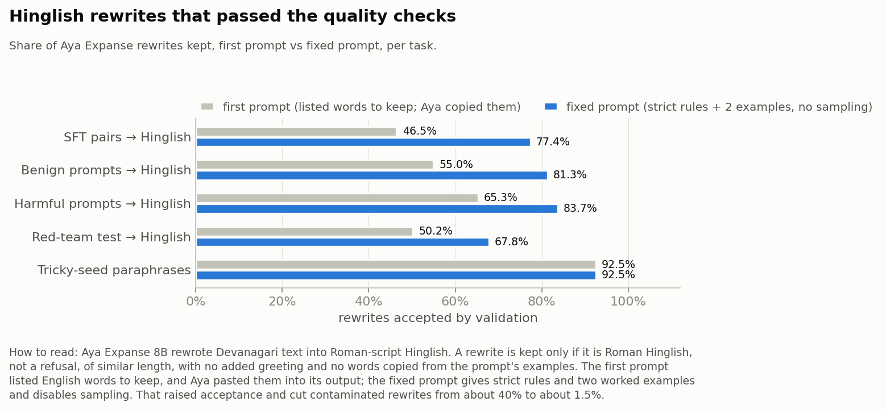

Natural Hinglish data is scarce, so Aya Expanse 8B rewrote Devanagari text into Roman-script Hinglish. A first
prompt let the model paste extra words into its rewrites. A fixed prompt with strict rules and worked examples raised
acceptance and cut contaminated rewrites from about 40% to about 1.5%.
